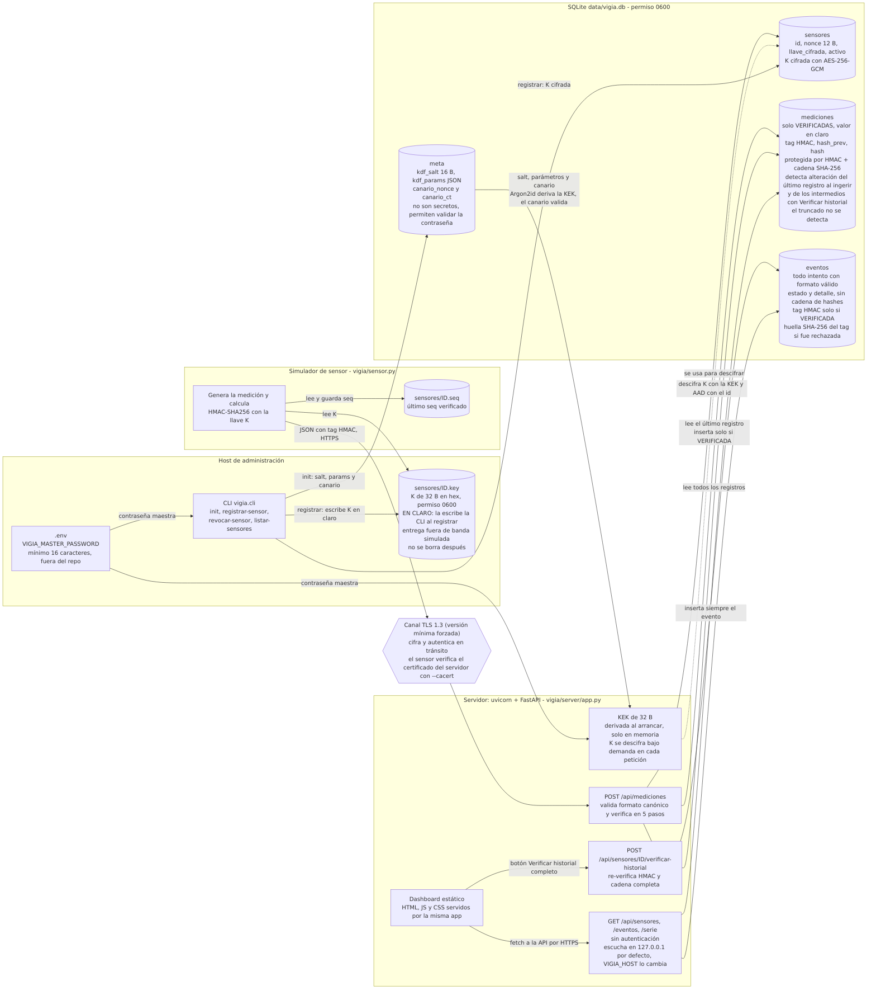

# Anexo A: protocolo, flujos, modelo de datos y API

Detalle técnico del protocolo y de la implementación que el informe principal (`docs/informe.md`) resume. Las referencias "sección N" remiten a ese informe; el texto proviene de la versión extendida (`docs/anexos/informe-completo.md`).

## A.0 Arquitectura detallada

Diagrama completo de componentes, canales y contenido de cada tabla (fuente `docs/diagramas/arquitectura.mmd`); el informe principal usa la versión resumida.



## A.1 Formato canónico `VIGIA-v1` (detalle)

```text
VIGIA-v1|<sensor_id>|<seq>|<timestamp_ms>|<valor>
Ejemplo: VIGIA-v1|sensor-01|42|1763140000123|23.475
```

Se codifica en UTF-8 y es lo que se autentica con HMAC. Todos los campos se validan **antes** de calcular o verificar el tag; si no cumplen, hay error de formato (HTTP 422) y no se toca la BD.

| Campo | Regla (`fullmatch`) |
|---|---|
| `sensor_id` | `[A-Za-z0-9_-]{1,64}`; no puede contener `\|` |
| `seq` | entero, 1 a 2^63 - 1; no se acepta un booleano como entero |
| `timestamp_ms` | entero, 0 o mayor (milisegundos Unix, UTC) |
| `valor` | `-?(0\|[1-9][0-9]{0,11})(\.[0-9]{1,6})?` |

**Por qué no es ambiguo.**

1. El separador `|` no puede aparecer dentro de ningún campo: el id lo prohíbe y los demás son numéricos. Por tanto, dos tuplas distintas nunca producen el mismo mensaje.
2. `valor` no admite ceros a la izquierda (`01.5` se rechaza) y `seq` y `timestamp_ms` se serializan desde enteros, sin relleno. Como el valor se autentica tal como llega, `0` y `-0` serían cadenas distintas con tags distintos; nunca se normalizan.
3. El `valor` se autentica **como cadena recibida**; nunca se reformatea un `float`, para que ambos lados tengan los mismos bytes.
4. Se usa `fullmatch`, no `$`, que aceptaría un salto de línea final.
5. El prefijo `VIGIA-v1` separa el dominio y versiona el formato: un tag de otro contexto no es válido aquí.

Los tests cubren el ejemplo del contrato, un `|` en el id, saltos de línea finales, valores float y decenas de entradas inválidas.

## A.2 Flujo del sensor: pasos, payload y recuperación

Pasos del simulador: (1) lee `sensores/<id>.key` (hex de 32 B; avisa si el permiso es más amplio que 0600 y rechaza llaves inválidas); (2) lee su último `seq` local; (3) genera el valor simulado (temperatura base con oscilación y ruido); (4) construye el mensaje canónico con `seq + 1` y el timestamp actual; (5) calcula `tag = HMAC-SHA256(K, mensaje)` en hex; (6) envía por HTTPS con verificación del certificado.

Payload (`POST /api/mediciones`, JSON):

```json
{"sensor_id": "sensor-01", "seq": 42, "timestamp_ms": 1763140000123,
 "valor": "23.475", "tag": "<64 hex>"}
```

El sensor avanza su `seq` local solo si el servidor responde `VERIFICADA`. Hay un caso de recuperación automática: si el servidor responde `replay: seq N <= última N` con N igual al `seq` enviado, la respuesta original se había perdido y el sensor avanza. Ante un hueco no hay corrección automática (sección 8). La recuperación automática confía en la respuesta del servidor: una fila final falsa con la `seq` esperada hace que el sensor descarte una medición antes de que aparezca `CADENA ROTA` (sigue fallando cerrado; nunca se encadena sobre la fila falsa).

## A.3 Verificación en 5 pasos: notas

`verificar_medicion` es una función pura y se detiene en el primer fallo. El orden es deliberado: primero se autentica (sin HMAC válido, ningún otro campo es confiable), luego la frescura (secuencia y tiempo) y al final la integridad del almacenamiento.

Notas:

- **FALSA** significa exactamente "sensor no registrado o revocado". Un mensaje fabricado con un id válido pero sin la llave falla en el paso 2 y es `MANIPULADA`.
- **REPLAY O HUECO** es un solo estado visible. El motivo (replay o hueco) queda en el campo `detalle` de cada evento, y el simulador lo usa para recuperarse del caso de respuesta perdida.
- Un mensaje `FUERA DE VENTANA` no consume el `seq`: no se guarda.
- Todo intento con formato válido, sea cual sea su estado, queda en `eventos` (con el tag si fue `VERIFICADA` y con su huella si fue rechazada). Solo las `VERIFICADA` entran a `mediciones`. Un formato inválido (HTTP 422) no se registra.
- Un mensaje sin HMAC válido se rechaza **antes** de mirar la secuencia (paso 2 antes del 3), así que quien no tiene K no puede consumir ni desincronizar la secuencia de un sensor.
- El paso 5 nunca lanza excepción por datos corruptos de la BD; devuelve `CADENA ROTA`. Un blob de llave ilegible produce un HTTP 500 genérico, sin detalles.

## A.4 Verificación de historial completo: casos

El botón del dashboard llama a `POST /api/sensores/{id}/verificar-historial`. `verificar_historial` recorre los registros por `seq` y, para cada uno, aplica este orden:

1. formato canónico (si falla: `MANIPULADA`, "formato inválido en BD");
2. que pertenezca al sensor y que su **HMAC** valide con K (si no: `MANIPULADA`);
3. continuidad de secuencia, enlace `hash_prev == hash` del anterior y hash recalculado (si falla: `CADENA ROTA`, con todos los motivos).

Cada registro se evalúa contra el anterior **tal como está guardado**, de modo que el daño se localiza donde ocurre. Funciona también para sensores revocados.

| Acción sobre la BD | Resultado en "Verificar historial completo" |
|---|---|
| Alterar el valor de una medición intermedia | `MANIPULADA` en ese registro (su HMAC ya no coincide) |
| Borrar una medición intermedia | `CADENA ROTA` en el registro siguiente (hueco de secuencia y enlace roto) |
| Insertar un registro con tag inventado | `MANIPULADA` (HMAC inválido) |
| Reemplazar o añadir una fila final falsa con el hash recalculado | `MANIPULADA` (HMAC inválido) en el historial; la siguiente ingesta legítima se rechaza (`CADENA ROTA` por el paso 5 si el `seq` de la fila coincide con el último, `REPLAY O HUECO` si no) y nunca se encadena sobre la fila falsa. El sensor puede descartar antes una medición por la recuperación automática (sección 4.2) |
| Borrar los últimos registros | **No detectable en el historial**: queda una cadena válida más corta. Operativamente se ve como `REPLAY O HUECO` en la siguiente medición del sensor (sección 8) |

## A.5 Manejo de llaves: tabla por etapa

| Etapa | Qué hace el código |
|---|---|
| Generación | `registrar-sensor` genera K de 32 B con `secrets.token_bytes` |
| Entrega (simulada fuera de banda) | K en claro solo en `sensores/<id>.key` (0600, directorio 0700, `O_EXCL`); se asocia al id. Se simula con un archivo; en un sensor real iría al firmware durante el aprovisionamiento. **El archivo permanece en disco**: no hay borrado tras la "entrega" |
| Cifrado en reposo | K se cifra con AES-256-GCM (nonce nuevo de 12 B, AAD = id) bajo la KEK. KEK = Argon2id(contraseña maestra, salt de 16 B único por BD). En la BD solo quedan `nonce` y `llave_cifrada` |
| Uso | La KEK vive solo en memoria; K se descifra por cada verificación y no se escribe |
| Revocación | `revocar-sensor` pone `activo = 0`; las mediciones posteriores dan `FALSA`. El historial sigue siendo verificable. El blob cifrado no se borra y no hay rotación de llaves. La revocación es solo ese flag en la BD, sin protección criptográfica: quien escriba en la BD puede reactivar el sensor, y quien tenga la K robada vuelve a obtener `VERIFICADA` |
| Arranque | Si la contraseña es incorrecta o los parámetros KDF están fuera de los mínimos o máximos (sección 3.6), el servidor no arranca |

## A.6 Argon2id: parámetros, cotas y política de contraseña

| Parámetro | Valor usado | Mínimo exigido al leer de la BD | Máximo aceptado al leer de la BD |
|---|---|---|---|
| `time_cost` (t) | 3 | 2 | 10 |
| `memory_cost` | 65536 KiB (64 MiB) | 19456 KiB (19 MiB) | 1048576 KiB (1 GiB) |
| `parallelism` (p) | 4 | 1 | 64 |
| `hash_len` | 32 B | exactamente 32 | exactamente 32 |
| Salt | 16 B de `os.urandom`, único por base de datos | al menos 16 B | - |

Los valores usados son la segunda opción recomendada de RFC 9106 §4 (t=3, m=64 MiB, p=4). Los mínimos son los de OWASP para Argon2id (m=19 MiB, t=2, p=1).

**Parámetros guardados con mínimos y máximos (N2).** Los parámetros se guardan en `meta.kdf_params` para poder reproducir la derivación. Como la BD puede haber sido alterada, `validar_params_argon2` exige el conjunto exacto de claves, enteros (no booleanos), `hash_len = 32`, valores **no inferiores a los mínimos** (contra la degradación del costo) y **no superiores a los máximos** (contra la denegación de servicio: unos parámetros enormes podrían agotar CPU o memoria al arrancar, o provocar una excepción no controlada). La validación se hace antes de derivar. Si no se cumple, el servidor no arranca y lo dice en el mensaje (`ArranqueError`, distinto de "contraseña incorrecta"); las excepciones de la derivación (`ValueError`, `TypeError`, `OverflowError`, `MemoryError`, `HashingError`) también se convierten en ese error.

**Alcance real de estas cotas.** Son defensa en profundidad. Editar `kdf_params` o el salt cambia la KEK derivada, el canario no descifra y el servidor no arranca: una edición no puede abaratar la KEK real. Los máximos evitan la denegación de servicio o la excepción no controlada al arrancar. Matiz: si los valores editados quedan **dentro** de las cotas, el mensaje es "contraseña incorrecta" (engañoso, porque el canario falla); el mensaje de parámetros inválidos solo aparece cuando los valores quedan **fuera** de ellas.

**Política de contraseña maestra.** La contraseña se lee de `VIGIA_MASTER_PASSWORD` (variable de entorno o `.env`, excluido del repo). Se exigen al menos 16 caracteres y se rechaza el valor de ejemplo de `.env.example`.

## A.7 Modelo de datos (SQLite)

| Tabla | Contenido | Observaciones |
|---|---|---|
| `meta` | `kdf_salt` (16 B), `kdf_params` (JSON), `canario_nonce`, `canario_ct` | Material no secreto para derivar la KEK; el canario valida la contraseña. `kdf_params` se valida con mínimos y máximos al leerlo (sección 3.6) |
| `sensores` | `id`, `nonce`, `llave_cifrada`, `activo`, `creado_ms` | La llave K solo existe cifrada (AES-256-GCM) |
| `mediciones` | `sensor_id`, `seq`, `timestamp_ms`, `valor`, `tag`, `hash_prev`, `hash`; `UNIQUE(sensor_id, seq)` | Solo mediciones VERIFICADAS; es la cadena protegida |
| `eventos` | Todo intento con formato válido, con `estado`, `detalle` y `tag` | Registro de auditoría para el dashboard; **no está encadenado**. El campo `tag` es el **tag HMAC solo si el estado es `VERIFICADA`** (ya está en `mediciones`); si fue rechazada guarda `huella_tag = "sha256:" + SHA-256("vigia-huella-tag\|" + tag)` (hallazgo N1, sección 7.3) |

**Por qué la huella.** Si `eventos` conservara el tag HMAC de un mensaje auténtico que fue rechazado (por ejemplo `FUERA DE VENTANA`), alguien con escritura en la BD podría copiarlo a `mediciones` y hacerlo pasar por una medición válida. Con la huella (un SHA-256 con separación de dominio, no invertible ni utilizable como tag) eso no es posible, pero se siguen pudiendo correlacionar intentos repetidos. El dashboard la rotula "huella" y, para las verificadas, "HMAC".

La ingesta es atómica: una transacción `BEGIN IMMEDIATE` lee el último registro del sensor, verifica e inserta. Así dos mensajes simultáneos no pueden saltarse la comprobación de secuencia.

## A.8 API (endpoints)

| Método y ruta | Función |
|---|---|
| `POST /api/mediciones` | Ingesta. Responde 200 con `{estado, detalle}` también para las rechazadas (es un resultado de verificación, no un error de transporte); 422 si el formato es inválido |
| `GET /api/config` | Descripción de la configuración (ventana de frescura y algoritmos) |
| `GET /api/sensores` | Resumen por sensor; nunca incluye la llave, ni cifrada |
| `GET /api/eventos` | Últimos eventos de todos los sensores |
| `GET /api/sensores/{id}/eventos` | Intentos de un sensor |
| `GET /api/sensores/{id}/serie` | Serie de mediciones verificadas |
| `POST /api/sensores/{id}/verificar-historial` | Re-verifica HMAC y cadena de todo el historial del sensor |
| `GET /` y `/static/*` | Dashboard |

Otros controles de la API: el modelo de entrada rechaza campos extra y tipos no estrictos; la documentación automática (`/docs`, `/openapi.json`) está desactivada; todas las respuestas llevan cabeceras de seguridad (CSP, `X-Content-Type-Options`, `Referrer-Policy`, `Strict-Transport-Security`) y las de `/api/` llevan `Cache-Control: no-store`.

## A.9 Dashboard

Una sola página con menú: **Resumen** (tarjetas, serie de tiempo de las mediciones verificadas y últimos eventos), **Mediciones** (tabla con fecha y hora, secuencia, valor, HMAC, estado con etiqueta de color y detalle; la columna del tag se rotula "HMAC" en las verificadas y "huella" en las rechazadas), **Historial** (gráfico y el botón **"Verificar historial completo del sensor"**, que muestra un banner íntegro/alterado y el estado por registro) y **Configuración** (parámetros y sensores). Hay un selector de sensor activo y se refresca periódicamente. Todo texto que viene de la API se inserta con `textContent`, nunca con `innerHTML`.

## A.10 CLI de administración

```text
python -m vigia.cli init                    # salt Argon2id único y canario en la BD
python -m vigia.cli registrar-sensor <id>   # genera K, la guarda cifrada y la entrega (simulada)
python -m vigia.cli revocar-sensor <id>     # desactiva el sensor
python -m vigia.cli listar-sensores
```

`registrar-sensor` guarda en la BD solo la llave cifrada y escribe la llave en claro únicamente en `sensores/<id>.key` (permiso 0600, directorio 0700, creación exclusiva sin sobrescribir), para simular la entrega fuera de banda. No se reutilizan ids.

