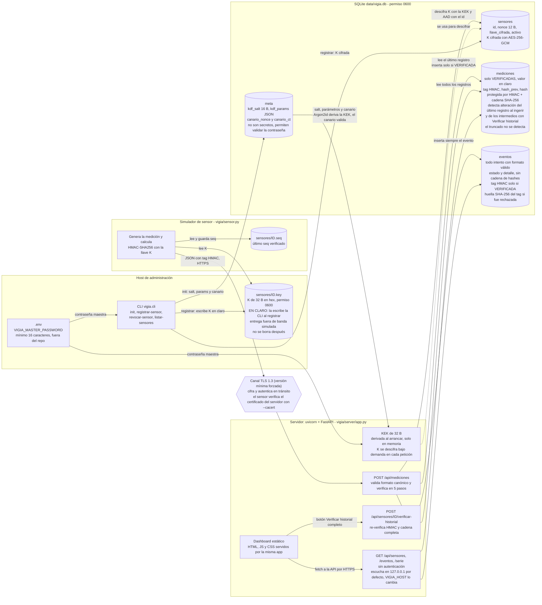
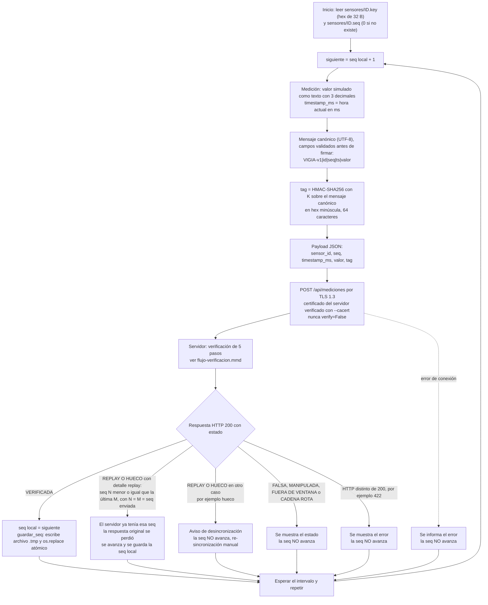
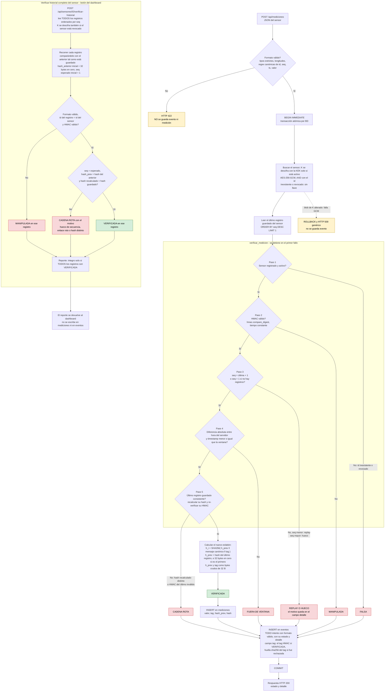
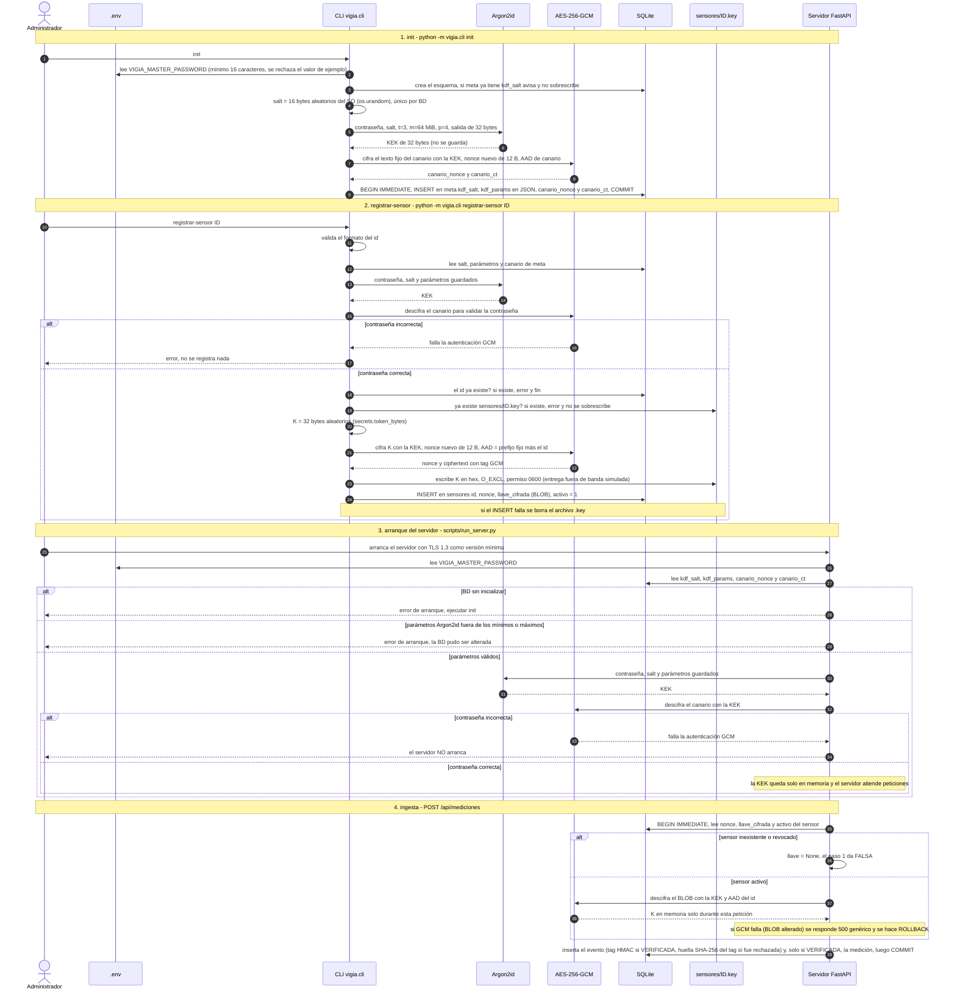
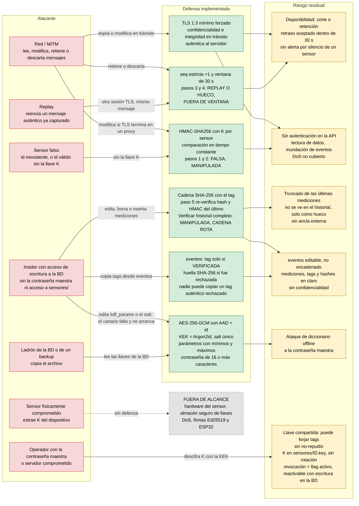

Versión extendida del informe; la versión principal es docs/informe.md.

# 1. Motivación

## 1.1 El problema

Los sistemas IoT toman decisiones a partir de mediciones: una alarma de temperatura, un control de riego, una auditoría de cadena de frío. Si el dato es falso, la decisión es falsa. Un atacante puede:

- **modificar** una medición (en la red o ya guardada);
- **inventar** mediciones de un sensor que no existe o de uno real sin tener su llave;
- **repetir** mensajes antiguos que eran legítimos (replay);
- **alterar o borrar** parte del historial en la base de datos.

VIGÍA es un sistema de telemetría en el que el servidor puede **verificar criptográficamente** cada medición y el historial completo de cada sensor, y muestra el resultado de esa verificación en un dashboard.

## 1.2 Qué garantiza VIGÍA

| Propiedad | Significado | Mecanismo |
|---|---|---|
| Autenticidad | La medición la produjo el sensor autorizado (el que posee su llave K) | HMAC-SHA256 con llave por sensor |
| Integridad | No fue modificada después de enviarse. Una modificación posterior se detecta (el último registro al ingerir, los intermedios con "Verificar historial completo") | HMAC; re-verificación del historial |
| Frescura | Una medición antigua no se reutiliza | Número de secuencia estricto y ventana de timestamp |
| Historial | La secuencia de mediciones mantiene su orden y no tiene huecos | Secuencia consecutiva y cadena de hashes SHA-256 que incluye el tag |

## 1.3 Qué NO garantiza VIGÍA

- **Confidencialidad de las mediciones.** Las mediciones, tags y hashes se guardan **en claro** en la base de datos. VIGÍA no oculta los datos: los hace verificables. En la red los protege TLS 1.3, pero cualquiera con acceso a la base de datos puede leerlos.
- No-repudio (el HMAC usa llave compartida; ver sección 8).
- Protección frente a un sensor físicamente comprometido ni frente a denegación de servicio (fuera de alcance).

Lo que sí se cifra en reposo son las **llaves K de los sensores**, porque con ellas se podrían forjar tags válidos (sección 6.2).

# 2. Descripción del sistema y arquitectura

## 2.1 Componentes

| Componente | Archivo | Función |
|---|---|---|
| Núcleo criptográfico | `vigia/crypto/` | Formato canónico, HMAC, cadena de hashes, keystore (AES-256-GCM y Argon2id), verificador. Funciones puras, sin E/S |
| Simulador de sensor | `vigia/sensor.py` | Genera temperaturas simuladas, calcula el HMAC y envía por HTTPS |
| API de verificación | `vigia/server/app.py` | FastAPI: valida formato, verifica y almacena, consulta, sirve el dashboard |
| Persistencia | `vigia/server/db.py` | SQLite con consultas parametrizadas; ingesta atómica |
| CLI de administración | `vigia/cli.py` | `init`, `registrar-sensor`, `revocar-sensor`, `listar-sensores` |
| Dashboard | `vigia/server/static/` | HTML, JavaScript y CSS sin dependencias de compilación; gráfico con Chart.js |
| Arranque TLS | `scripts/run_server.py` | Uvicorn con TLS 1.3 como versión mínima |
| Scripts de apoyo | `scripts/` | Certificado de desarrollo, verificación de TLS, vista de la BD robada, análisis estático |

## 2.2 Diagrama de arquitectura

Fuente: `docs/diagramas/arquitectura.mmd` (con `arquitectura.png` si se generó).



Figura 1: arquitectura de VIGÍA (componentes, canal TLS 1.3 y qué se protege en cada punto).

En texto: el sensor calcula el tag y envía el mensaje por HTTPS (TLS 1.3). La API valida el formato, descifra bajo demanda la llave K del sensor, ejecuta los cinco pasos de verificación y, si todo es correcto, guarda la medición con su hash de cadena. Cada intento con formato válido (aceptado o rechazado) queda además en la tabla de eventos: con el tag HMAC si fue `VERIFICADA` y solo con la huella SHA-256 del tag si fue rechazada (sección 2.3). El dashboard consulta la API.

## 2.3 Modelo de datos (SQLite)

| Tabla | Contenido | Observaciones |
|---|---|---|
| `meta` | `kdf_salt` (16 B), `kdf_params` (JSON), `canario_nonce`, `canario_ct` | Material no secreto para derivar la KEK; el canario valida la contraseña. `kdf_params` se valida con mínimos y máximos al leerlo (sección 3.6) |
| `sensores` | `id`, `nonce`, `llave_cifrada`, `activo`, `creado_ms` | La llave K solo existe cifrada (AES-256-GCM) |
| `mediciones` | `sensor_id`, `seq`, `timestamp_ms`, `valor`, `tag`, `hash_prev`, `hash`; `UNIQUE(sensor_id, seq)` | Solo mediciones VERIFICADAS; es la cadena protegida |
| `eventos` | Todo intento con formato válido, con `estado`, `detalle` y `tag` | Registro de auditoría para el dashboard; **no está encadenado**. El campo `tag` es el **tag HMAC solo si el estado es `VERIFICADA`** (ya está en `mediciones`); si fue rechazada guarda `huella_tag = "sha256:" + SHA-256("vigia-huella-tag\|" + tag)` (hallazgo N1, sección 7.3) |

**Por qué la huella.** Si `eventos` conservara el tag HMAC de un mensaje auténtico que fue rechazado (por ejemplo `FUERA DE VENTANA`), alguien con escritura en la BD podría copiarlo a `mediciones` y hacerlo pasar por una medición válida. Con la huella (un SHA-256 con separación de dominio, no invertible ni utilizable como tag) eso no es posible, pero se siguen pudiendo correlacionar intentos repetidos. El dashboard la rotula "huella" y, para las verificadas, "HMAC".

La ingesta es atómica: una transacción `BEGIN IMMEDIATE` lee el último registro del sensor, verifica e inserta. Así dos mensajes simultáneos no pueden saltarse la comprobación de secuencia.

## 2.4 API (endpoints)

| Método y ruta | Función |
|---|---|
| `POST /api/mediciones` | Ingesta. Responde 200 con `{estado, detalle}` también para las rechazadas (es un resultado de verificación, no un error de transporte); 422 si el formato es inválido |
| `GET /api/config` | Descripción de la configuración (ventana de frescura y algoritmos) |
| `GET /api/sensores` | Resumen por sensor; nunca incluye la llave, ni cifrada |
| `GET /api/eventos` | Últimos eventos de todos los sensores |
| `GET /api/sensores/{id}/eventos` | Intentos de un sensor |
| `GET /api/sensores/{id}/serie` | Serie de mediciones verificadas |
| `POST /api/sensores/{id}/verificar-historial` | Re-verifica HMAC y cadena de todo el historial del sensor |
| `GET /` y `/static/*` | Dashboard |

Otros controles de la API: el modelo de entrada rechaza campos extra y tipos no estrictos; la documentación automática (`/docs`, `/openapi.json`) está desactivada; todas las respuestas llevan cabeceras de seguridad (CSP, `X-Content-Type-Options`, `Referrer-Policy`, `Strict-Transport-Security`) y las de `/api/` llevan `Cache-Control: no-store`.

## 2.5 Dashboard

Una sola página con menú: **Resumen** (tarjetas, serie de tiempo de las mediciones verificadas y últimos eventos), **Mediciones** (tabla con fecha y hora, secuencia, valor, HMAC, estado con etiqueta de color y detalle; la columna del tag se rotula "HMAC" en las verificadas y "huella" en las rechazadas), **Historial** (gráfico y el botón **"Verificar historial completo del sensor"**, que muestra un banner íntegro/alterado y el estado por registro) y **Configuración** (parámetros y sensores). Hay un selector de sensor activo y se refresca periódicamente. Todo texto que viene de la API se inserta con `textContent`, nunca con `innerHTML`.

## 2.6 CLI de administración

```text
python -m vigia.cli init                    # salt Argon2id único y canario en la BD
python -m vigia.cli registrar-sensor <id>   # genera K, la guarda cifrada y la entrega (simulada)
python -m vigia.cli revocar-sensor <id>     # desactiva el sensor
python -m vigia.cli listar-sensores
```

`registrar-sensor` guarda en la BD solo la llave cifrada y escribe la llave en claro únicamente en `sensores/<id>.key` (permiso 0600, directorio 0700, creación exclusiva sin sobrescribir), para simular la entrega fuera de banda. No se reutilizan ids.

# 3. Justificación de algoritmos y librerías

## 3.1 Resumen

| Función | Elección | Librería |
|---|---|---|
| Autenticación del mensaje | HMAC-SHA256, llave de 256 bits por sensor | `hmac`, `hashlib`, `secrets` (biblioteca estándar) |
| Comparación de tags | `hmac.compare_digest` (tiempo constante) | `hmac` |
| Historial | Cadena SHA-256 que incluye el tag | `hashlib` |
| Llaves en reposo | AES-256-GCM, nonce de 96 bits aleatorio, AAD | `cryptography` |
| Derivación de la llave de cifrado | Argon2id, salt de 16 B | `argon2-cffi` |
| Transporte | TLS 1.3 (mínimo forzado) | `ssl` de Python sobre OpenSSL; Uvicorn |
| Aleatoriedad | `secrets` y `os.urandom` (CSPRNG del SO) | biblioteca estándar |

No se usa MD5, SHA-1, ECB ni ninguna construcción propia. Ed25519 (PyNaCl) y ESP32 real quedaron como extensión y **no** están implementados.

## 3.2 HMAC-SHA256

**Por qué un MAC simétrico y no una firma digital.** El servidor es el único verificador y conoce a cada sensor desde el registro. Un MAC cubre el requisito (autenticidad e integridad extremo a extremo) con una etiqueta de 32 bytes y un costo de cómputo mínimo, apropiado para dispositivos pequeños. Una firma (Ed25519) añadiría no-repudio, pero el modelo del proyecto no lo exige. El costo de esa decisión es honesto y se documenta: el servidor conoce K y podría forjar tags (sección 8).

**Por qué HMAC y no `SHA-256(K || m)`.** La construcción ingenua es vulnerable a extensión de longitud. HMAC es la construcción estándar y probada; se usa su implementación de la biblioteca estándar.

**Por qué SHA-256.** Es un hash vigente, sin ataques prácticos conocidos, de la familia SHA-2 recomendada por NIST, y viene en la biblioteca estándar. La seguridad de HMAC además no depende de la resistencia a colisiones del hash. La llave de 32 bytes (`secrets.token_bytes`) tiene 256 bits de entropía.

**Qué cubre el tag.** El mensaje canónico completo (sección 4.1): versión, `sensor_id`, `seq`, `timestamp_ms` y `valor`. Cambiar cualquiera de ellos invalida el tag.

## 3.3 Comparación en tiempo constante

`verificar_tag` decodifica el tag recibido (exige exactamente 64 hex en minúscula; si no, devuelve `False`), recalcula el HMAC y compara con `hmac.compare_digest`. Una comparación `==` termina en el primer byte distinto y filtra por tiempo cuántos bytes acertó el atacante. Se exige minúscula para que cada tag tenga una única representación textual.

## 3.4 Cadena de hashes con el tag

```text
h_0 = 32 bytes en cero
h_i = SHA-256( h_{i-1} || mensaje_canónico_i || tag_i )      (h y tag como 32 bytes crudos)
```

Cada registro compromete al anterior y a la autenticación del propio mensaje, de modo que borrar o editar un registro intermedio rompe el enlace del registro siguiente. Con el `seq` autenticado por el HMAC (va en el mensaje canónico), la cadena sin llave no añade detección frente a un insider sin K; su valor es resumir todo el historial en un hash y permitir un ancla externa (trabajo futuro). Los campos `h` y `tag` tienen largo fijo (32 B), así que la concatenación no es ambigua.

**Limitación que hay que decir con claridad:** SHA-256 no lleva llave. Por sí sola, la cadena no impide que alguien con escritura en la BD recalcule una cadena entera. La detección de inserciones y ediciones viene del **HMAC** (el atacante no tiene K) y de su re-verificación; la cadena aporta el **enlace** entre registros y un resumen verificable de todo el historial (el orden ya lo autentica el HMAC, porque `seq` forma parte del mensaje). Por eso el paso 5 y la verificación completa re-verifican también el HMAC (sección 7.3).

## 3.5 AES-256-GCM (llaves de sensor en reposo)

- **AEAD**: confidencialidad y autenticidad en una sola operación. Un blob alterado, o descifrado con otra contraseña, falla con `InvalidTag`.
- **Nonce de 96 bits** (12 B) de `os.urandom`, **nuevo en cada cifrado**. Repetir (llave, nonce) en GCM rompería el esquema. Con nonces aleatorios, el riesgo de colisión es despreciable para el número de cifrados que hace VIGÍA (uno por sensor y el canario).
- **AAD** = `b"vigia-sensor-key|" + sensor_id`. Une cada blob a su sensor: copiar el blob de un sensor a la fila de otro hace fallar el descifrado. El canario usa otro AAD (`b"vigia-canario"`), de modo que un canario no se confunde con una llave.
- **Canario**: al inicializar se cifra un texto fijo. Al arrancar, si la contraseña es incorrecta el canario no descifra y el servidor aborta antes de tocar llaves de sensor.
- La KEK vive solo en memoria del proceso. Las llaves de sensor se descifran bajo demanda.

## 3.6 Argon2id (derivación de la llave de cifrado)

La llave de cifrado (KEK, 32 B) se deriva de la contraseña maestra con Argon2id. Es memory-hard, lo que encarece los ataques de diccionario con GPU o ASIC si se roba la BD, y es la variante recomendada por RFC 9106.

| Parámetro | Valor usado | Mínimo exigido al leer de la BD | Máximo aceptado al leer de la BD |
|---|---|---|---|
| `time_cost` (t) | 3 | 2 | 10 |
| `memory_cost` | 65536 KiB (64 MiB) | 19456 KiB (19 MiB) | 1048576 KiB (1 GiB) |
| `parallelism` (p) | 4 | 1 | 64 |
| `hash_len` | 32 B | exactamente 32 | exactamente 32 |
| Salt | 16 B de `os.urandom`, único por base de datos | al menos 16 B | - |

Los valores usados son la segunda opción recomendada de RFC 9106 §4 (t=3, m=64 MiB, p=4). Los mínimos son los de OWASP para Argon2id (m=19 MiB, t=2, p=1).

**Parámetros guardados con mínimos y máximos (N2).** Los parámetros se guardan en `meta.kdf_params` para poder reproducir la derivación. Como la BD puede haber sido alterada, `validar_params_argon2` exige el conjunto exacto de claves, enteros (no booleanos), `hash_len = 32`, valores **no inferiores a los mínimos** (contra la degradación del costo) y **no superiores a los máximos** (contra la denegación de servicio: unos parámetros enormes podrían agotar CPU o memoria al arrancar, o provocar una excepción no controlada). La validación se hace antes de derivar. Si no se cumple, el servidor no arranca y lo dice en el mensaje (`ArranqueError`, distinto de "contraseña incorrecta"); las excepciones de la derivación (`ValueError`, `TypeError`, `OverflowError`, `MemoryError`, `HashingError`) también se convierten en ese error.

**Alcance real de estas cotas.** Son defensa en profundidad. Editar `kdf_params` o el salt cambia la KEK derivada, el canario no descifra y el servidor no arranca: una edición no puede abaratar la KEK real. Los máximos evitan la denegación de servicio o la excepción no controlada al arrancar. Matiz: si los valores editados quedan **dentro** de las cotas, el mensaje es "contraseña incorrecta" (engañoso, porque el canario falla); el mensaje de parámetros inválidos solo aparece cuando los valores quedan **fuera** de ellas.

**Política de contraseña maestra.** La contraseña se lee de `VIGIA_MASTER_PASSWORD` (variable de entorno o `.env`, excluido del repo). Se exigen al menos 16 caracteres y se rechaza el valor de ejemplo de `.env.example`.

## 3.7 TLS 1.3 y por qué igual hace falta HMAC

TLS 1.3 protege el canal sensor-servidor contra espionaje y modificación **en la red**. VIGÍA lo fuerza: el servidor fija `minimum_version = TLSv1_3` en el contexto SSL que usa Uvicorn, y el simulador crea su contexto con `ssl.create_default_context(cafile=...)` (verifica cadena y hostname), también con mínimo TLS 1.3 y sin `verify=False`.

Pero un canal seguro no resuelve el problema de fondo. **Lo que TLS no cubre**:

| Riesgo | Por qué TLS no basta | Qué lo cubre en VIGÍA |
|---|---|---|
| Autenticidad del sensor extremo a extremo | TLS autentica al **servidor**; aquí el sensor no presenta certificado de cliente. Cualquiera que alcance el puerto puede abrir una sesión TLS válida y enviar datos. Además TLS termina en el servidor (o en un proxy intermedio) y no dice nada sobre quién generó el dato | HMAC con la llave K propia de cada sensor: sin K el tag no valida (`MANIPULADA`); id inexistente: `FALSA` |
| Replay a nivel de aplicación | Un mensaje legítimo reenviado dentro de **otra** sesión TLS es perfectamente válido para TLS | Secuencia estricta (+1) y ventana de timestamp (`REPLAY O HUECO`, `FUERA DE VENTANA`) |
| Huecos y orden | TLS entrega bytes; no sabe qué mediciones faltan ni en qué orden deberían ir | Secuencia consecutiva y cadena de hashes que incluye el tag (`REPLAY O HUECO`, `CADENA ROTA`) |
| Manipulación de lo almacenado (insider o BD alterada) | Una vez que el dato llega al servidor y se guarda, TLS ya no lo protege | Re-verificación de HMAC y cadena ("Verificar historial completo"; paso 5 sobre el último registro) |

Esto responde al comentario recibido en la Entrega 1: TLS protege el tránsito, y el HMAC se justifica por la autenticidad del origen, la frescura a nivel de aplicación, el orden del historial y la integridad de lo almacenado.

## 3.8 Librerías y por qué no hay criptografía casera

| Librería | Uso |
|---|---|
| `hmac`, `hashlib`, `secrets` (biblioteca estándar) | HMAC-SHA256, SHA-256, `compare_digest`, llaves aleatorias |
| `cryptography` (50.0.2) | AES-256-GCM (`AESGCM`) |
| `argon2-cffi` (25.1.0) | Argon2id (`hash_secret_raw`, `Type.ID`) |
| `ssl` / OpenSSL | TLS 1.3 |
| FastAPI, Uvicorn, httpx, python-dotenv | Aplicación, servidor, cliente y configuración (no criptográficas) |

El código del proyecto **no implementa ningún primitivo**: solo compone funciones de librerías ampliamente probadas. Un primitivo propio no tiene revisión pública, y errores sutiles (canales laterales, nonces, relleno) son invisibles en pruebas funcionales. Las versiones están fijadas en `requirements.txt`.

# 4. Protocolo y flujos criptográficos

## 4.1 Formato canónico `VIGIA-v1`

```text
VIGIA-v1|<sensor_id>|<seq>|<timestamp_ms>|<valor>
Ejemplo: VIGIA-v1|sensor-01|42|1763140000123|23.475
```

Se codifica en UTF-8 y es lo que se autentica con HMAC. Todos los campos se validan **antes** de calcular o verificar el tag; si no cumplen, hay error de formato (HTTP 422) y no se toca la BD.

| Campo | Regla (`fullmatch`) |
|---|---|
| `sensor_id` | `[A-Za-z0-9_-]{1,64}`; no puede contener `\|` |
| `seq` | entero, 1 a 2^63 - 1; no se acepta un booleano como entero |
| `timestamp_ms` | entero, 0 o mayor (milisegundos Unix, UTC) |
| `valor` | `-?(0\|[1-9][0-9]{0,11})(\.[0-9]{1,6})?` |

**Por qué no es ambiguo.**

1. El separador `|` no puede aparecer dentro de ningún campo: el id lo prohíbe y los demás son numéricos. Por tanto, dos tuplas distintas nunca producen el mismo mensaje.
2. `valor` no admite ceros a la izquierda (`01.5` se rechaza) y `seq` y `timestamp_ms` se serializan desde enteros, sin relleno. Como el valor se autentica tal como llega, `0` y `-0` serían cadenas distintas con tags distintos; nunca se normalizan.
3. El `valor` se autentica **como cadena recibida**; nunca se reformatea un `float`, para que ambos lados tengan los mismos bytes.
4. Se usa `fullmatch`, no `$`, que aceptaría un salto de línea final.
5. El prefijo `VIGIA-v1` separa el dominio y versiona el formato: un tag de otro contexto no es válido aquí.

Los tests cubren el ejemplo del contrato, un `|` en el id, saltos de línea finales, valores float y decenas de entradas inválidas.

## 4.2 Flujo del sensor y payload

Fuente: `docs/diagramas/flujo-sensor.mmd`.



Figura 2: flujo del sensor, del valor medido al envío con su tag HMAC.

Pasos del simulador: (1) lee `sensores/<id>.key` (hex de 32 B; avisa si el permiso es más amplio que 0600 y rechaza llaves inválidas); (2) lee su último `seq` local; (3) genera el valor simulado (temperatura base con oscilación y ruido); (4) construye el mensaje canónico con `seq + 1` y el timestamp actual; (5) calcula `tag = HMAC-SHA256(K, mensaje)` en hex; (6) envía por HTTPS con verificación del certificado.

Payload (`POST /api/mediciones`, JSON):

```json
{"sensor_id": "sensor-01", "seq": 42, "timestamp_ms": 1763140000123,
 "valor": "23.475", "tag": "<64 hex>"}
```

El sensor avanza su `seq` local solo si el servidor responde `VERIFICADA`. Hay un caso de recuperación automática: si el servidor responde `replay: seq N <= última N` con N igual al `seq` enviado, la respuesta original se había perdido y el sensor avanza. Ante un hueco no hay corrección automática (sección 8). La recuperación automática confía en la respuesta del servidor: una fila final falsa con la `seq` esperada hace que el sensor descarte una medición antes de que aparezca `CADENA ROTA` (sigue fallando cerrado; nunca se encadena sobre la fila falsa).

## 4.3 Verificación en 5 pasos

Fuente: `docs/diagramas/flujo-verificacion.mmd`.



Figura 3: verificación de 5 pasos, almacenamiento y verificación del historial completo.

`verificar_medicion` es una función pura y se detiene en el primer fallo. El orden es deliberado: primero se autentica (sin HMAC válido, ningún otro campo es confiable), luego la frescura (secuencia y tiempo) y al final la integridad del almacenamiento.

| Paso | Pregunta | Si falla | Detalle interno |
|---|---|---|---|
| 1 | ¿El sensor está registrado y activo? (el servidor devuelve la llave o nada) | **FALSA** | "sensor no registrado o revocado" |
| 2 | ¿El HMAC es válido (tiempo constante)? | **MANIPULADA** | "HMAC inválido" |
| 3 | ¿`seq` es exactamente última + 1 (o 1 si no hay registros)? | **REPLAY O HUECO** | `replay: seq N <= última M` o `hueco: esperaba E, llegó N` |
| 4 | ¿`abs(ahora - timestamp)` está dentro de la ventana (30 s por defecto, `VIGIA_VENTANA_MS`)? | **FUERA DE VENTANA** | "desfase X ms > ventana Y ms" |
| 5 | ¿El último registro guardado es consistente? Recalcula su hash **y re-verifica su HMAC** | **CADENA ROTA** | hash que no coincide, formato inválido o HMAC inválido del último registro |
| - | Todo correcto | **VERIFICADA** | Se guarda con `hash = SHA-256(hash_anterior ∥ canónico ∥ tag)` |

Notas:

- **FALSA** significa exactamente "sensor no registrado o revocado". Un mensaje fabricado con un id válido pero sin la llave falla en el paso 2 y es `MANIPULADA`.
- **REPLAY O HUECO** es un solo estado visible. El motivo (replay o hueco) queda en el campo `detalle` de cada evento, y el simulador lo usa para recuperarse del caso de respuesta perdida.
- Un mensaje `FUERA DE VENTANA` no consume el `seq`: no se guarda.
- Todo intento con formato válido, sea cual sea su estado, queda en `eventos` (con el tag si fue `VERIFICADA` y con su huella si fue rechazada). Solo las `VERIFICADA` entran a `mediciones`. Un formato inválido (HTTP 422) no se registra.
- Un mensaje sin HMAC válido se rechaza **antes** de mirar la secuencia (paso 2 antes del 3), así que quien no tiene K no puede consumir ni desincronizar la secuencia de un sensor.
- El paso 5 nunca lanza excepción por datos corruptos de la BD; devuelve `CADENA ROTA`. Un blob de llave ilegible produce un HTTP 500 genérico, sin detalles.

## 4.4 Verificación de historial completo

El botón del dashboard llama a `POST /api/sensores/{id}/verificar-historial`. `verificar_historial` recorre los registros por `seq` y, para cada uno, aplica este orden:

1. formato canónico (si falla: `MANIPULADA`, "formato inválido en BD");
2. que pertenezca al sensor y que su **HMAC** valide con K (si no: `MANIPULADA`);
3. continuidad de secuencia, enlace `hash_prev == hash` del anterior y hash recalculado (si falla: `CADENA ROTA`, con todos los motivos).

Cada registro se evalúa contra el anterior **tal como está guardado**, de modo que el daño se localiza donde ocurre. Funciona también para sensores revocados.

| Acción sobre la BD | Resultado en "Verificar historial completo" |
|---|---|
| Alterar el valor de una medición intermedia | `MANIPULADA` en ese registro (su HMAC ya no coincide) |
| Borrar una medición intermedia | `CADENA ROTA` en el registro siguiente (hueco de secuencia y enlace roto) |
| Insertar un registro con tag inventado | `MANIPULADA` (HMAC inválido) |
| Reemplazar o añadir una fila final falsa con el hash recalculado | `MANIPULADA` (HMAC inválido) en el historial; la siguiente ingesta legítima se rechaza (`CADENA ROTA` por el paso 5 si el `seq` de la fila coincide con el último, `REPLAY O HUECO` si no) y nunca se encadena sobre la fila falsa. El sensor puede descartar antes una medición por la recuperación automática (sección 4.2) |
| Borrar los últimos registros | **No detectable en el historial**: queda una cadena válida más corta. Operativamente se ve como `REPLAY O HUECO` en la siguiente medición del sensor (sección 8) |

## 4.5 Manejo de llaves

Fuente: `docs/diagramas/flujo-almacenamiento.mmd`.



Figura 4: manejo de llaves (init, registrar-sensor, arranque e ingesta).

| Etapa | Qué hace el código |
|---|---|
| Generación | `registrar-sensor` genera K de 32 B con `secrets.token_bytes` |
| Entrega (simulada fuera de banda) | K en claro solo en `sensores/<id>.key` (0600, directorio 0700, `O_EXCL`); se asocia al id. Se simula con un archivo; en un sensor real iría al firmware durante el aprovisionamiento. **El archivo permanece en disco**: no hay borrado tras la "entrega" |
| Cifrado en reposo | K se cifra con AES-256-GCM (nonce nuevo de 12 B, AAD = id) bajo la KEK. KEK = Argon2id(contraseña maestra, salt de 16 B único por BD). En la BD solo quedan `nonce` y `llave_cifrada` |
| Uso | La KEK vive solo en memoria; K se descifra por cada verificación y no se escribe |
| Revocación | `revocar-sensor` pone `activo = 0`; las mediciones posteriores dan `FALSA`. El historial sigue siendo verificable. El blob cifrado no se borra y no hay rotación de llaves. La revocación es solo ese flag en la BD, sin protección criptográfica: quien escriba en la BD puede reactivar el sensor, y quien tenga la K robada vuelve a obtener `VERIFICADA` |
| Arranque | Si la contraseña es incorrecta o los parámetros KDF están fuera de los mínimos o máximos (sección 3.6), el servidor no arranca |

# 5. Análisis de amenazas

## 5.1 Modelo de atacante y supuestos

Se consideran siete atacantes:

| Atacante | Qué puede hacer |
|---|---|
| Red / MITM | Leer, modificar, retener, descartar o reenviar el tráfico entre sensor y servidor |
| Sensor falso | Enviar mensajes con un `sensor_id` inexistente, o con uno válido pero sin conocer su llave K |
| Replay | Reenviar mensajes auténticos que capturó antes |
| Insider con acceso a la BD | Leer y **escribir** el archivo SQLite. No conoce K ni la contraseña maestra, no tiene acceso al directorio `sensores/` y no controla el proceso del servidor |
| Ladrón de la BD o de un backup | Obtiene una copia del archivo, sin la contraseña maestra |
| Operador con la contraseña maestra, o servidor comprometido | Conoce la KEK, puede descifrar todas las K y ejecutar código en el servidor |
| Sensor físicamente comprometido | Extrae K del dispositivo |

**Supuestos.**

- K se genera con CSPRNG (256 bits); la conocen el sensor y el servidor (cifrada en la BD), y además queda en claro en `sensores/<id>.key` (0600) en el host donde se registró (sección 8). Se supone que el insider con acceso a la BD no tiene acceso a ese directorio.
- La contraseña maestra es secreta y tiene entropía suficiente. VIGÍA solo exige 16 caracteres y no mide la entropía (sección 8).
- Las primitivas (HMAC-SHA256, SHA-256, AES-256-GCM, Argon2id, TLS 1.3) y sus implementaciones en las librerías usadas son seguras.
- Mientras el servidor no esté comprometido, ejecuta el código sin modificar. El insider modifica el archivo de la BD, no la memoria del proceso.
- Los relojes del sensor y del servidor están razonablemente sincronizados (la ventana es de 30 s).
- El sensor verifica el certificado del servidor con `--cacert`. El certificado de desarrollo es autofirmado.
- Fuera de alcance: el hardware del sensor, la denegación de servicio, el no-repudio y la confidencialidad de las mediciones almacenadas (sección 1.3).

## 5.2 Qué cubre TLS y qué no

TLS 1.3 cubre el **tramo de red**: confidencialidad e integridad del tráfico entre el sensor y el servidor y autenticación del servidor mediante su certificado. Eso mitiga el espionaje y la modificación en tránsito.

TLS **no** cubre lo siguiente, y por eso VIGÍA añade HMAC, secuencia y cadena (detalle en la sección 3.7):

- **Autenticidad del sensor extremo a extremo.** TLS autentica al servidor, no al sensor: aquí no hay certificado de cliente, y cualquiera que alcance el puerto abre una sesión TLS válida. Además TLS termina en el servidor (o en un proxy), por lo que no dice nada sobre quién generó el dato. El HMAC con la K de cada sensor sí lo dice.
- **Replay a nivel de aplicación.** Un mensaje legítimo reenviado en otra sesión TLS es válido para TLS. La secuencia estricta y la ventana de timestamp lo rechazan.
- **Huecos y orden.** TLS entrega bytes, no sabe qué mediciones faltan. La secuencia consecutiva y la cadena de hashes sí.
- **Manipulación de lo almacenado por un insider o una BD alterada.** Cuando el dato llega al servidor, TLS ya no lo protege. La re-verificación del HMAC y de la cadena sí.

## 5.3 Amenazas, mitigaciones y riesgo residual

| Amenaza | Mitigación (estado observable) | Riesgo residual |
|---|---|---|
| **Modificación en tránsito** (MITM cambia el valor) | TLS 1.3 lo detecta (AEAD) y corta la conexión; no impide que el MITM descarte el tráfico. Si el mensaje viajara por un tramo sin TLS o por un proxy, el HMAC cubre versión, `sensor_id`, `seq`, `timestamp_ms` y `valor`: cualquier cambio da `MANIPULADA` | Un proxy que termine TLS ve los datos en claro: el HMAC da integridad, no confidencialidad |
| **Espionaje en tránsito** | TLS 1.3 forzado como versión mínima (comprobado: `TLS_AES_256_GCM_SHA384`; TLS 1.2 rechazado). El HMAC **no** cifra | Metadatos visibles (direcciones, tamaños, tiempos). Un certificado autofirmado mal distribuido permitiría un MITM; el cliente solo confía en el certificado que se le da con `--cacert` |
| **Sensor falso / id inexistente** | Paso 1: sin llave registrada o activa, `FALSA`; no se guarda medición | Un id válido sin llave da `MANIPULADA` y uno inexistente da `FALSA`: la respuesta permite enumerar ids registrados, y `GET /api/sensores` lista todos los ids sin autenticación. Cada intento con formato válido deja una fila en `eventos` |
| **Falsificación con id válido sin la llave** | Paso 2: el HMAC no valida (`hmac.compare_digest`, tiempo constante): `MANIPULADA`. Adivinar un tag de 256 bits es inviable | Ninguno práctico sin K. Con K, véase "servidor comprometido" y "sensor físico" |
| **Replay** de un mensaje aceptado | Paso 3: la secuencia debe ser exactamente última + 1; si no, `REPLAY O HUECO` (`replay: seq N <= última M`), aunque llegue por otra sesión TLS | Ninguno para mensajes ya aceptados |
| **Eliminación de un mensaje en tránsito** | TLS no impide que alguien corte la conexión. El sensor no avanza su `seq` sin `VERIFICADA` y reintenta; si se perdió la respuesta de un mensaje ya guardado, el simulador lo reconoce (replay de la misma `seq`) y avanza. Cualquier otra desincronización se rechaza como `REPLAY O HUECO` (fail-closed) | Es una pérdida de disponibilidad: el dato no llega. No hay alerta cuando un sensor guarda silencio |
| **Retraso / mensaje viejo** | El `timestamp_ms` está dentro del tag: no se puede ajustar. Paso 4: fuera de ±30 s (`VIGIA_VENTANA_MS`) da `FUERA DE VENTANA`, sin guardar ni consumir la `seq`. La secuencia estricta impide además reutilizar un mensaje ya aceptado | Un mensaje retenido y entregado dentro de la ventana se acepta si su `seq` es la esperada. Depende de relojes sincronizados |
| **Alteración de un valor guardado** (insider o BD alterada, sin K) | El HMAC ya no coincide: "Verificar historial completo" da `MANIPULADA` en ese registro. Si es el último, la siguiente ingesta da `CADENA ROTA` (el hash recalculado no coincide) | Una alteración intermedia solo se ve al verificar el historial, que es una acción manual; no hay verificación automática |
| **Borrado intermedio** | Se rompen la continuidad de `seq` y el enlace `hash_prev`: `CADENA ROTA` en el registro siguiente | Igual que arriba: detección bajo demanda |
| **Inserción de una fila final falsa** (con hash recalculado) | SHA-256 no lleva llave y por sí solo no lo impediría. El paso 5 **re-verifica el HMAC del último registro**: `CADENA ROTA`; el historial la marca `MANIPULADA`. Si el `seq` de la fila no es el esperado, `REPLAY O HUECO`. En todos los casos la medición legítima siguiente se rechaza y no se encadena sobre la fila falsa | La recuperación automática del sensor confía en la respuesta del servidor: una fila final falsa con la `seq` esperada hace que el sensor descarte una medición antes de que aparezca `CADENA ROTA` (sigue fallando cerrado). Sin K el insider no puede fabricar un tag válido. Con K, véase "servidor comprometido" |
| **Promoción de un mensaje auténtico rechazado** (copiar su tag desde `eventos` a `mediciones`) | `eventos` guarda el tag completo solo si fue `VERIFICADA` (ya está en `mediciones`). Si fue rechazada (p. ej. `FUERA DE VENTANA`) guarda solo la huella `sha256:` + SHA-256 de `"vigia-huella-tag\|" + tag`, que no es un tag válido ni se puede invertir (N1) | Ninguno por esta vía. La huella solo permite correlacionar intentos repetidos |
| **Truncado de las últimas mediciones** | El historial no lo detecta: queda una cadena válida más corta. Operativamente la siguiente medición del sensor, que ya avanzó su `seq`, llega con un hueco y recibe `REPLAY O HUECO` (N3) | No hay ancla externa del último hash o `seq`. La señal depende de que el sensor siga enviando y no distingue truncado de desincronización |
| **Edición de la tabla `eventos`** | Ninguna criptográfica: no está encadenada. No afecta a `mediciones`, y desde N1 ya no contiene tags de mensajes rechazados | El registro de intentos que muestra el dashboard no es confiable ante un insider. La fuente de verdad es `mediciones` con su verificación |
| **Robo de la BD o de un backup** | Las llaves K están cifradas con AES-256-GCM (nonce único, AAD = id) bajo una KEK derivada con Argon2id (salt único de 16 B, t=3, m=64 MiB, p=4). Sin la contraseña no se descifran y un blob copiado a otro sensor falla | Mediciones, tags, hashes y eventos están **en claro**: no hay confidencialidad. Se puede atacar la contraseña sin conexión (el canario sirve de verificador), frenado por Argon2id |
| **Contraseña maestra débil** | Política: al menos 16 caracteres y se rechaza el valor de `.env.example`. Argon2id encarece cada intento | El largo no garantiza entropía: una contraseña larga y predecible la cumple. Si es débil, el robo de la BD compromete todas las K |
| **Degradación o DoS por `kdf_params`** | Se validan antes de derivar: mínimos (t >= 2, m >= 19456 KiB, p >= 1) contra la degradación y máximos (t <= 10, m <= 1 GiB, p <= 64) contra el DoS y las excepciones no controladas (N2). Es defensa en profundidad: editar `kdf_params` o el salt cambia la KEK, el canario no descifra y el servidor no arranca, así que no se puede abaratar la KEK real. Con valores fuera de las cotas el error es de parámetros | Quien edite `kdf_params` o el salt puede impedir el arranque (falla cerrado). Si los valores editados quedan dentro de las cotas, el mensaje es "contraseña incorrecta", engañoso. Dentro de las cotas el costo puede llegar a 1 GiB y t = 10 |
| **Servidor comprometido o insider con la KEK** | Ninguna. La llave es compartida: quien tiene la KEK descifra cada K, puede forjar tags válidos, insertar mediciones con cadena consistente y suplantar sensores. No hay no-repudio | **Alto, aceptado.** Mitigación futura: firmas Ed25519 por sensor, de modo que el servidor no tenga una llave capaz de firmar |
| **API sin autenticación / DoS** | Escucha en 127.0.0.1 por defecto. Sin K nada se acepta, y un mensaje sin HMAC válido no consume la `seq` (el paso 2 va antes que el 3), así que no se puede desincronizar a un sensor. El modelo de entrada limita tipos y largos | Cualquiera que alcance el puerto lee datos y envía intentos (se llena `eventos`). No hay autenticación ni límite de tasa. DoS **fuera de alcance** |
| **Sensor físicamente comprometido** | **Fuera de alcance.** Quien extraiga K se hace pasar por el sensor. Revocarlo (`revocar-sensor`) hace que lo posterior dé `FALSA`; lo ya guardado sigue verificable | Sin defensa: no hay almacén seguro de llaves ni rotación. Además `sensores/<id>.key` queda en disco en claro (0600) tras la "entrega". La revocación es un flag `activo` sin protección criptográfica: un insider con escritura en la BD puede reactivar un sensor revocado y quien tenga la K robada vuelve a obtener `VERIFICADA` |

## 5.4 Diagrama del modelo de amenazas

Fuente: `docs/diagramas/modelo-amenazas.mmd`.



Figura 5: modelo de amenazas (atacante, defensa, riesgo residual y lo fuera de alcance).

## 5.5 Lectura de conjunto

- **Cubierto por diseño:** modificación y espionaje en tránsito (TLS), falsificación sin K, replay, mensajes viejos, y alteración, borrado intermedio e inserción en lo almacenado por quien no tiene K.
- **Detectado solo bajo demanda u operativamente:** las alteraciones intermedias (hay que pulsar "Verificar historial completo") y el truncado (se ve como hueco).
- **Aceptado como limitación:** el servidor o el operador con la KEK puede forjar (llave compartida), la API no tiene autenticación, `eventos` no es confiable ante un insider y las mediciones no son confidenciales.
- **Fuera de alcance:** el sensor físicamente comprometido y la denegación de servicio.

# 6. Seguridad práctica

## 6.1 En tránsito: TLS 1.3 forzado

- `scripts/generar_cert.sh` crea un certificado autofirmado **solo de desarrollo**: EC P-256, SAN `IP:127.0.0.1, DNS:localhost`, `CA:FALSE`, uso `digitalSignature` y `serverAuth`, 365 días. `certs/` está en `.gitignore`.
- `scripts/run_server.py` fija `ssl.TLSVersion.TLSv1_3` como versión mínima del contexto que usa Uvicorn.
- El simulador exige `--cacert`, verifica cadena y hostname, y exige TLS 1.3.

Evidencia real (`docs/evidencia/tls-y-simulador.txt`, 2026-11-14) con `scripts/verificar_tls.sh`:

| Prueba | Resultado |
|---|---|
| `openssl s_client -tls1_3` | `Protocol: TLSv1.3`, cipher `TLS_AES_256_GCM_SHA384`, `Verify return code: 0 (ok)` |
| `openssl s_client -tls1_2` | Rechazado: `New, (NONE), Cipher is (NONE)` |
| `curl --tls-max 1.2` | exit 35 (fallo de handshake) |
| `curl` sin `--cacert` | exit 60 (certificado no confiable) |
| Simulador con `--cacert`, 3 mediciones | 3 × `VERIFICADA`; historial `integro: true`, total 3 |

En el mismo archivo se comprueban los permisos: `data/` y `sensores/` 700; `data/vigia.db`, `sensores/sensor-01.key` y `certs/key.pem` 600.

## 6.2 En reposo

| Dato | ¿Cifrado? | Decisión |
|---|---|---|
| Llaves K de sensores (`sensores.llave_cifrada`) | **Sí**: AES-256-GCM con KEK Argon2id | Son el secreto que permitiría forjar tags |
| Mediciones, tags y hashes (`mediciones`) | No | VIGÍA protege **integridad, no confidencialidad**; un atacante con la BD puede leerlas. Alterar, borrar una intermedia o insertar una fila se detecta al verificar el historial; borrar las últimas no (sección 8) |
| Eventos | No | Registro de auditoría; sin encadenar. El tag completo solo se guarda en las `VERIFICADA`; en las rechazadas solo su huella SHA-256 (N1) |
| Contraseña maestra | No está en la BD ni en el repo | Variable de entorno o `.env` (ignorado por git) |
| `sensores/<id>.key` | En claro, 0600 | Simula la entrega fuera de banda al sensor |

Se puede mostrar con `scripts/mostrar_bd.py`, que abre la BD en solo lectura, no usa la contraseña, imprime nonce y blob de la tabla `sensores` y comprueba que la llave en claro del archivo no aparece en el blob (48 B: 32 B cifrados y 16 B de tag GCM), y luego muestra las mediciones en claro.

Si hiciera falta confidencialidad de las mediciones, se añadiría cifrado de columnas con la misma KEK, a costa de perder consultas SQL directas.

Archivos y secretos: `.env`, `*.key`, `*.pem`, `certs/`, `sensores/`, `data/` y `*.db` están en `.gitignore`; solo `.env.example`, sin secretos, es público. La BD se crea con permiso 0600 y su directorio con 0700.

## 6.3 Análisis estático

Herramientas: **bandit** 1.9.4 (patrones de código inseguro en Python) y **pip-audit** 2.10.1 (vulnerabilidades conocidas en dependencias). Python 3.14.10. Se ejecutan con:

```bash
.venv/bin/pip install -r requirements-dev.txt
scripts/analisis_estatico.sh
```

El script deja los resultados en `docs/analisis-estatico/` (`bandit.txt`, `bandit.json`, `bandit-tests.txt`, `pip-audit*.txt`, `VERSIONES.txt`).

| Alcance | Herramienta | Resultado |
|---|---|---|
| Código de la aplicación (`vigia/` y `scripts/`, 1589 líneas) | bandit | **0 hallazgos** (ninguna severidad) |
| Dependencias de ejecución (`requirements.txt`) | pip-audit | **0 vulnerabilidades conocidas** |
| Dependencias de desarrollo (`requirements-dev.txt`) | pip-audit | **0 vulnerabilidades conocidas** |
| Tests (`tests/`, 1053 líneas) | bandit | 202 hallazgos: 201 × B101 y 1 × B105, **falsos positivos** |

**Falsos positivos justificados (solo en `tests/`).**

- **B101 `assert_used` (201).** Bandit advierte que `assert` desaparece con `python -O`, lo que importa si protege un control de seguridad en producción. En VIGÍA no hay ningún `assert` en el código de producción (0 hallazgos en `vigia/` y `scripts/`). En los tests, `assert` es el mecanismo de pytest.
- **B105 `hardcoded_password_string` (1, `tests/conftest.py:28`).** Es la contraseña maestra de prueba, con la que los tests crean BD temporales en `tmp_path` que se destruyen. No protege datos reales. La contraseña real solo se lee de `VIGIA_MASTER_PASSWORD`.

Por qué el código sale limpio: las consultas SQL son parametrizadas; no se usa `subprocess`, `eval` ni `pickle`; la aleatoriedad criptográfica viene de `secrets` y `os.urandom`; no hay hashes rotos ni modos inseguros. El único uso de `random` es `random.gauss` en el simulador, que solo genera ruido de temperatura sin papel criptográfico (el comentario `# nosec B311` es preventivo: bandit reporta 0 líneas omitidas).

**Limitación.** Bandit es análisis de patrones: **no prueba la ausencia de errores lógicos** (por ejemplo, un orden incorrecto de pasos de verificación no lo ve). Por eso se complementa con los tests de estados y ataques y con una revisión de seguridad independiente (sección 7).

# 7. Evaluación de resultados

## 7.1 Qué se logró frente al diseño

| Elemento del diseño | Estado |
|---|---|
| HMAC-SHA256 por sensor, tag en hex, comparación en tiempo constante | Implementado |
| Formato canónico `VIGIA-v1` con validación estricta | Implementado |
| Verificación de 5 pasos con los 6 estados | Implementado |
| Cadena SHA-256 que incluye el tag | Implementado |
| Verificación de historial completo | Implementado (API y dashboard) |
| AES-256-GCM para llaves, nonce único, AAD | Implementado |
| Argon2id con salt único y parámetros RFC 9106 | Implementado, con parámetros guardados y validados con mínimos y máximos |
| Huella del tag en `eventos` para mensajes rechazados (hallazgo N1) | Implementado |
| TLS 1.3 en tránsito | Implementado y comprobado con `openssl` y `curl` |
| Simulador, API, dashboard y CLI | Implementados |
| Análisis estático | bandit y pip-audit ejecutados; resultados en el repo |
| Ed25519, ESP32 real | **No implementados** (extensión) |

## 7.2 Pruebas

`.venv/bin/python -m pytest -q` ejecuta 266 tests, todos pasan (1 advertencia de deprecación de `starlette.testclient` con `httpx`, sin relación con la seguridad).

| Archivo | Tests | Qué cubre |
|---|---|---|
| `tests/test_crypto.py` | 90 | Formato canónico (válidos e inválidos), HMAC contra la implementación estándar, robustez ante hex inválido, cadena, Argon2id, unicidad de salts y nonces, AAD, AES-GCM, canario |
| `tests/test_estados.py` | 18 | **Un test por estado**: VERIFICADA, FALSA (inexistente y revocado), MANIPULADA, REPLAY O HUECO (con su detalle interno), FUERA DE VENTANA (pasado y futuro) y CADENA ROTA; independencia entre sensores; registro de eventos |
| `tests/test_ataques.py` | 46 | **Un test por ataque** (numerados 1 a 8): alterar un valor en la BD, fabricar con id válido sin llave y con id inexistente, replay, borrar una intermedia, mensaje perdido, timestamp fuera de ventana, romper la cadena (hash, `hash_prev`, tags reordenados), contraseña incorrecta o BD sin inicializar, blob copiado a otro sensor, formato inválido (422) y no filtración de llaves en las respuestas |
| `tests/test_fase2.py` | 74 | Regresiones de la primera revisión independiente (sección 7.3) |
| `tests/test_fase3.py` | 38 | Regresiones de la re-verificación: huella del tag en `eventos` (N1), cotas máximas de `kdf_params` (N2) y casos asociados |

## 7.3 Hallazgos de la revisión de seguridad independiente y su corrección

Hubo dos rondas de revisión independiente (un revisor distinto de quien implementó): una al cierre de la Fase 2 y una re-verificación acotada al inicio de la Fase 3. Cada corrección de código tiene tests de regresión (`tests/test_fase2.py` y `tests/test_fase3.py`); las correcciones que son solo de documentación se revisaron leyendo el texto.

### Primera revisión independiente (cierre de la Fase 2)

| Id | Severidad | Hallazgo | Corrección |
|---|---|---|---|
| M1 | Media | El paso 5 no re-verificaba el HMAC del último registro: SHA-256 no lleva llave, así que una fila final falsa con hash recalculado servía de base de la cadena | El paso 5 **re-verifica el HMAC del último registro** además de su hash; un último registro con formato corrupto da `CADENA ROTA` sin excepción. Corregido |
| M2 | Media | Limitaciones no documentadas y una afirmación falsa en `seguridad-practica.md` ("no pueden modificar/borrar/insertar sin que se detecte") | Se documentaron las limitaciones (sección 8) y se corrigió la afirmación (también en la sección 6.2 de este informe). Corregido |
| B1 | Baja | El sensor quedaba en un bucle de `REPLAY O HUECO` tras perder la respuesta | Avance automático solo en el caso estricto "el servidor ya tiene esta `seq`"; el resto exige re-sincronización manual (fail-closed). Corregido |
| B2 | Baja | API y dashboard sin autenticación | Documentado como limitación (sección 8) |
| B3 | Baja | Afirmaciones de documentación desactualizadas (`nosec`, comentario de un test) | Texto corregido |
| B4 | Baja | Contraseña maestra sin política mínima | Mínimo de 16 caracteres y rechazo del valor de `.env.example`. Corregido |
| B5 | Baja | Los parámetros Argon2 guardados en la BD no se usaban para derivar | Se leen y se usan, validados con mínimos (después, también con máximos: N2). Corregido |
| I1 | Info | Una llave de sensor corrupta producía un error 500 | Manejador que responde HTTP 500 genérico, sin traceback ni detalles, y registra el error en el log; el resto de sensores no se ve afectado. Corregido |
| I2 | Info | Sin validación de la llave en el simulador | `leer_llave` valida hex y longitud y sale con un mensaje claro. Corregido |
| I3 | Info | Permisos de la BD según el umask | BD 0600 y directorio 0700; llaves 0600 en directorio 0700. Corregido |
| I4 | Info | Diseño frente a código: `MANIPULADA` frente a `CADENA ROTA` al alterar una intermedia | Documentado (secciones 4.4 y 9) |
| I5 | Info | Handshake TLS real sin evidencia | Se agregó `docs/evidencia/` con `scripts/verificar_tls.sh` (sección 6.1) |
| I6 | Info | Integridad de subrecursos (SRI) de Chart.js | Verificado: el hash coincide; sin cambios |

### Re-verificación acotada (inicio de la Fase 3)

El revisor comprobó las correcciones anteriores: todas quedaron **cerradas**, salvo documentación parcial, que se completó al cerrar el informe. Encontró tres hallazgos nuevos:

| Id | Severidad | Hallazgo | Corrección |
|---|---|---|---|
| N1 | Baja | **Promoción de un mensaje auténtico rechazado.** `eventos` guardaba el tag de todo intento; alguien con escritura en la BD podía copiar el tag de un mensaje auténtico rechazado (por ejemplo `FUERA DE VENTANA`) a `mediciones` y hacerlo pasar por válido | `eventos` guarda el tag solo si es `VERIFICADA` y, en las rechazadas, solo la huella `sha256:` + SHA-256 de `"vigia-huella-tag\|" + tag`. El dashboard rotula "HMAC" o "huella". Corregido |
| N2 | Baja | **Sin cotas superiores en Argon2.** Unos `kdf_params` manipulados podían causar denegación de servicio o una excepción no controlada al arrancar | Máximos (t <= 10, m <= 1 GiB, p <= 64) además de los mínimos; las excepciones de la derivación se convierten en un error de arranque claro. Corregido |
| N3 | Info | **Precisión sobre el truncado.** El borrado de las últimas mediciones no se detecta en el historial; sí se detecta operativamente como hueco | Precisión documentada (sección 8) |

Además, la API añade cabeceras de seguridad (CSP, `nosniff`, `Referrer-Policy`, HSTS, `no-store`) y el dashboard usa `textContent` en lugar de `innerHTML`.

Dos observaciones de la propia implementación, hechas durante la documentación:

- Si se altera el **valor del último registro guardado**, la ingesta siguiente da `CADENA ROTA` (el hash recalculado no coincide), no `MANIPULADA`.
- Si se altera el **`seq` del último registro**, la ingesta siguiente da `REPLAY O HUECO` en vez de `CADENA ROTA` (sección 8).

# 8. Fallas y limitaciones

Todas son decisiones o límites aceptados; ninguna está oculta.

| Limitación | Detalle y consecuencia |
|---|---|
| Re-sincronización manual tras un mensaje perdido (fail-closed) | El sensor se recupera solo si el servidor ya tiene exactamente esa `seq`. Ante un hueco (el servidor está atrasado) se rechaza todo hasta una re-sincronización manual. Se prefiere esto a aceptar datos con huecos. Si `sensores/<id>.seq` se pierde o se corrompe, `leer_seq` devuelve 0 y el sensor queda en `REPLAY O HUECO` permanente (el servidor está adelantado); también requiere re-sincronización manual |
| La tabla `eventos` no está encadenada | Un insider con acceso a la BD puede editar el registro de intentos que muestra el dashboard (estados, detalles, valores). La tabla protegida es `mediciones`. Desde N1 ya no puede obtener tags auténticos de ahí, porque en las rechazadas solo hay huella |
| Alteración intermedia solo detectada con "Verificar historial completo" | La ingesta normal solo re-verifica el último registro guardado. Una edición en medio no se ve hasta verificar todo el historial |
| Truncado de las últimas mediciones | **No se detecta en el historial**: si se borran los registros finales, queda una cadena válida más corta, y no hay ancla externa del último hash o `seq`. **Sí se detecta operativamente** (precisión N3): el sensor ya avanzó su `seq`, su siguiente medición llega con un hueco y el servidor responde `REPLAY O HUECO` (también si se restaura un respaldo antiguo); el sensor queda detenido hasta una re-sincronización manual. Esa señal depende de que el sensor siga enviando y no distingue un truncado de una desincronización |
| HMAC de llave compartida | El servidor conoce K y podría forjar tags válidos; no hay no-repudio. Mitigación futura: firmas Ed25519 por sensor |
| API y dashboard sin autenticación | Escuchan en 127.0.0.1 por defecto. Cualquiera que alcance el puerto puede consultar datos y enviar intentos (que quedan en `eventos`, incluso con ids inexistentes). DoS fuera de alcance |
| Alterar el `seq` del último registro se etiqueta `REPLAY O HUECO` en vez de `CADENA ROTA` | El orden de 5 pasos del diseño pone la secuencia (paso 3) antes de la cadena (paso 5). **En ambos casos se rechaza** la medición; solo cambia la etiqueta |
| El dashboard depende de `cdnjs.cloudflare.com` | Chart.js se carga de un CDN con Subresource Integrity (SRI) y la CSP lo permite. Sin red, el dashboard funciona sin gráfico. Una alternativa sería servir Chart.js localmente |
| Certificado autofirmado solo para desarrollo | En producción se usaría una CA real. El cliente se configura con ese certificado como su "CA" |
| Sensor simulado, no hardware | No se prueba un dispositivo real ni protecciones de hardware (almacén seguro de llaves) |
| El archivo `sensores/<id>.key` queda en disco | `registrar-sensor` escribe K en claro (0600) para simular la entrega y no se borra después; no hay rotación de llaves. Quien lea ese archivo (o el respaldo del directorio `sensores/`) puede forjar tags de ese sensor |
| Gestión de llaves básica | La revocación no borra el blob cifrado; la KEK y la contraseña maestra residen en memoria y entorno del proceso |
| La política de contraseña es de largo, no de entropía | Se exigen 16 caracteres y se rechaza el valor de ejemplo, pero una contraseña larga y predecible la cumple. Si se roba la BD, el canario permite probar candidatos sin conexión (frenados por Argon2id) |
| `kdf_params` editable | Las cotas son defensa en profundidad: editar `kdf_params` o el salt cambia la KEK y el canario falla, así que no se puede abaratar la KEK real, y los máximos evitan el DoS o la excepción no controlada al arrancar. Quien los edite puede impedir el arranque (falla cerrado; es una denegación de servicio, no un compromiso de llaves). Si los valores editados quedan dentro de las cotas, el mensaje es "contraseña incorrecta", engañoso |
| La revocación es un flag sin protección criptográfica | `sensores.activo` no está autenticado: un insider con escritura en la BD puede reactivar un sensor revocado, y quien tenga la K robada vuelve a obtener `VERIFICADA`. La revocación efectiva exigiría rotar K |
| La recuperación automática del sensor confía en el servidor | Una fila final falsa con la `seq` esperada hace que el sensor descarte una medición antes de que aparezca `CADENA ROTA`. Sigue fallando cerrado: nunca se encadena sobre la fila falsa |
| Reloj | La frescura por timestamp depende de relojes sincronizados (ventana de 30 s). La defensa principal contra el replay es la secuencia, no el reloj |

# 9. Cambios respecto a la Entrega 1

| Tema | Entrega 1 | Implementación |
|---|---|---|
| Estado `FALSA` | Ambiguo ("falsa" por fabricación) | Solo **sensor no registrado o revocado**. Fabricar con un id válido sin la llave da `MANIPULADA` |
| `REPLAY O HUECO` | Replay y hueco | Un solo estado visible; el motivo (replay o hueco) va en el campo de detalle |
| Cadena de hashes | `h_i` sobre el mensaje | `h_i = SHA256(h_{i-1} ∥ mensaje ∥ tag_i)`: **incluye el tag** |
| Paso 5 | Consistencia de la cadena | Además **re-verifica el HMAC del último registro** (hallazgo de la revisión) |
| Alterar o borrar una intermedia | `CADENA ROTA` para ambos | Alterar el valor da `MANIPULADA` (el HMAC se comprueba antes que la cadena); borrar da `CADENA ROTA` |
| TLS | TLS 1.3 | TLS 1.3 como **mínimo forzado** y comprobado |
| Justificación del HMAC | Implícita | Basada en lo que TLS no cubre (sección 3.7), según el feedback |
| Argon2id | Salt único | Además, parámetros guardados con mínimos y máximos (N2) y política de contraseña maestra |
| Registro de intentos (`eventos`) | No se especificaba qué guarda | Tag HMAC solo si `VERIFICADA`; huella SHA-256 si fue rechazada (N1) |
| Truncado | No se trataba | No se detecta en el historial; se ve como `REPLAY O HUECO` en la siguiente medición (N3) |
| Ed25519, ESP32 | Extensión opcional | **Quedan como extensión**; no se implementan |

# 10. Conclusiones y trabajo futuro

## 10.1 Conclusiones

- VIGÍA demuestra que un MAC simétrico, una secuencia estricta y una cadena de hashes ofrecen autenticidad, integridad, frescura e historial **además** de TLS, y cubren justo lo que TLS no cubre: origen extremo a extremo, replay de aplicación, orden y manipulación de lo almacenado.
- Un diseño por capas exige cuidado en la composición. Una cadena de hashes sin llave no basta sola; el hallazgo de la fila final falsa (M1) lo mostró y se corrigió con la re-verificación del HMAC; el hallazgo N1 mostró lo mismo con los tags guardados en `eventos`.
- La criptografía se obtuvo íntegramente de librerías probadas, y el análisis estático y los 266 tests respaldan la implementación (sin sustituir una revisión experta).

## 10.2 Trabajo futuro

1. **Firmas Ed25519 por sensor** (PyNaCl) para eliminar la llave compartida y dar no-repudio; sensor real (ESP32).
2. **Ancla externa** del último hash y `seq` (por ejemplo, un registro firmado y publicado periódicamente) para detectar truncado.
3. **Encadenar o firmar la tabla `eventos`**.
4. Autenticación de API y dashboard; limitación de tasa.
5. Verificación completa periódica y automática, con alertas.
6. Rotación de llaves y borrado seguro al revocar; HSM o almacén seguro en el sensor.
7. Servir Chart.js localmente y usar certificados de una CA real.
8. Confidencialidad opcional de las mediciones (cifrado de columnas).

# Anexo: cómo reproducir

La guía completa y los comandos con salidas esperadas están en `docs/seguridad-practica.md`. Resumen, desde la raíz del repositorio (`Vigia/`):

```bash
python3 -m venv .venv
.venv/bin/pip install -r requirements.txt
cp .env.example .env     # editar VIGIA_MASTER_PASSWORD (16+ caracteres, no el valor de ejemplo)
python3 -c "import secrets; print(secrets.token_urlsafe(32))"   # genera una buena

scripts/generar_cert.sh                                   # certificado de desarrollo -> certs/
.venv/bin/python -m vigia.cli init                        # salt Argon2id + canario
.venv/bin/python -m vigia.cli registrar-sensor sensor-01  # llave -> sensores/sensor-01.key
.venv/bin/python scripts/run_server.py                    # https://127.0.0.1:8443 (TLS 1.3 mínimo)

# en otra terminal
.venv/bin/python -m vigia.sensor --sensor sensor-01 --cacert certs/cert.pem --n 3 --intervalo 1
scripts/verificar_tls.sh                                  # TLS 1.3 aceptado, TLS 1.2 rechazado
.venv/bin/python scripts/mostrar_bd.py                    # la BD robada: llaves cifradas, datos en claro
```

Dashboard: `https://127.0.0.1:8443/` (el navegador avisará del certificado autofirmado).

Tests y análisis estático:

```bash
.venv/bin/python -m pytest -q                 # 266 passed
.venv/bin/pip install -r requirements-dev.txt
scripts/analisis_estatico.sh                  # resultados en docs/analisis-estatico/
```

Evidencias en el repositorio: `docs/evidencia/tls-y-simulador.txt` y `docs/analisis-estatico/`. Diagramas (Mermaid, en `docs/diagramas/`): `arquitectura.mmd`, `flujo-sensor.mmd`, `flujo-verificacion.mmd`, `flujo-almacenamiento.mmd` y `modelo-amenazas.mmd`.

Conversión de este informe: `pandoc docs/informe.md -o informe.pdf` (o `.docx`).
