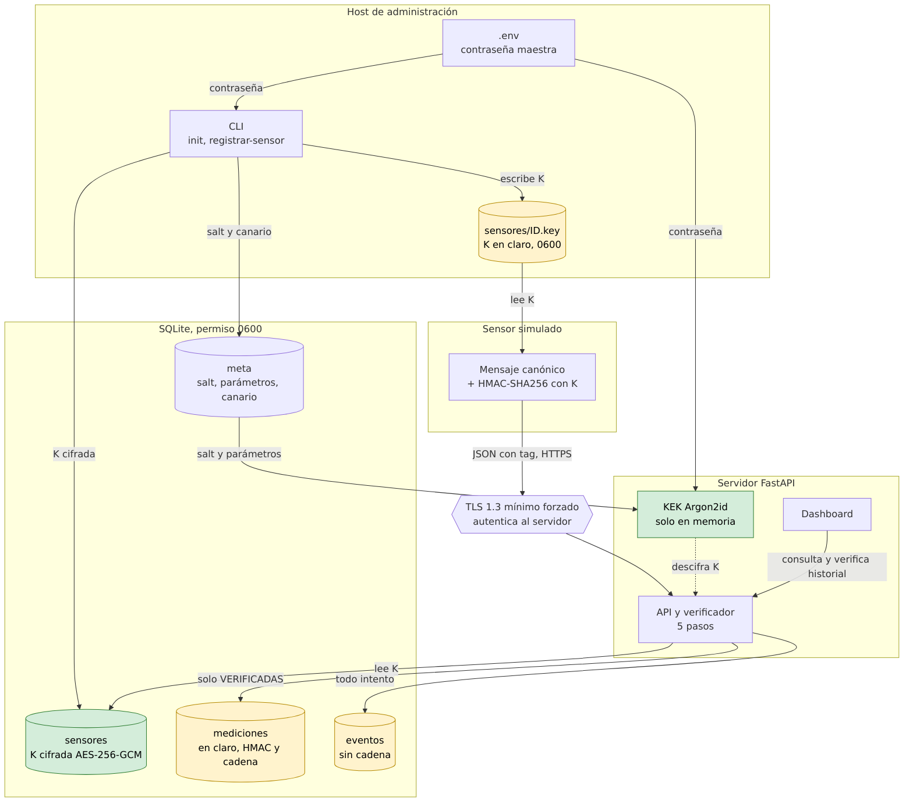
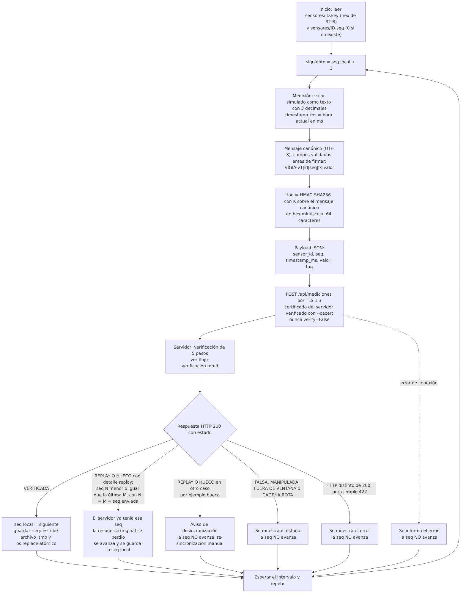
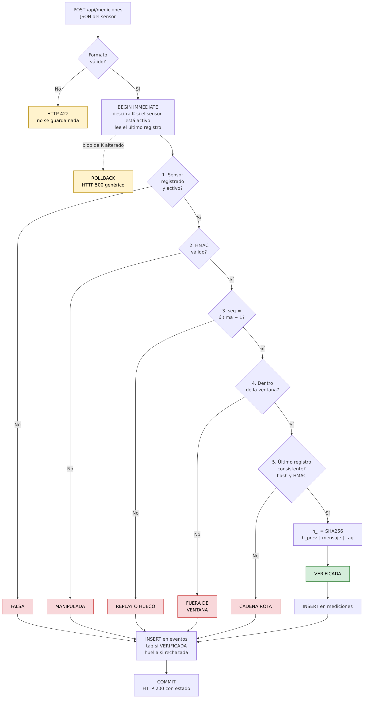
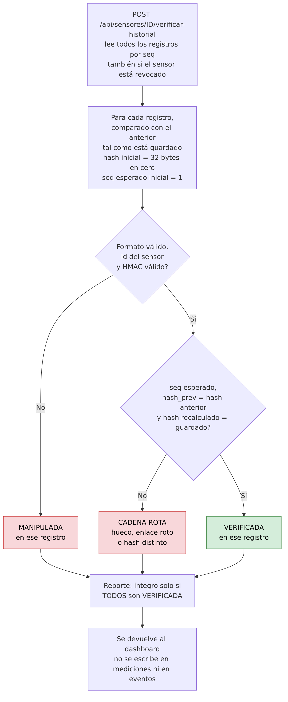
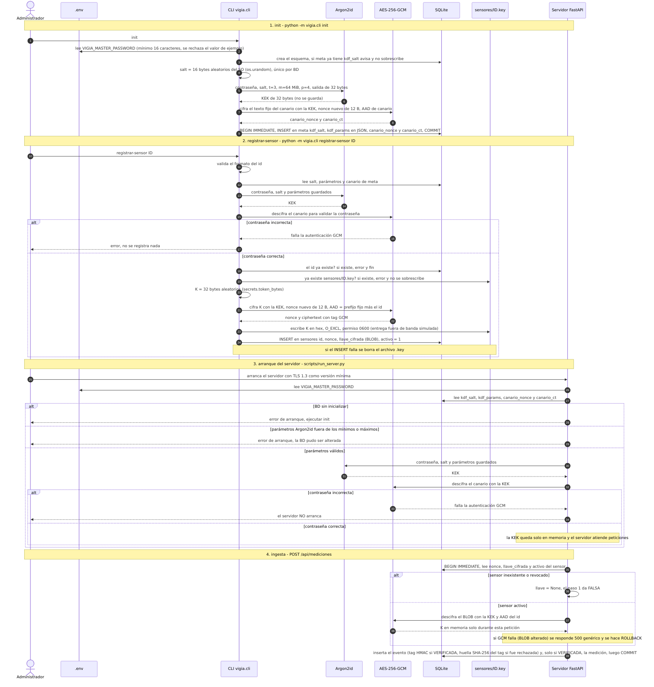
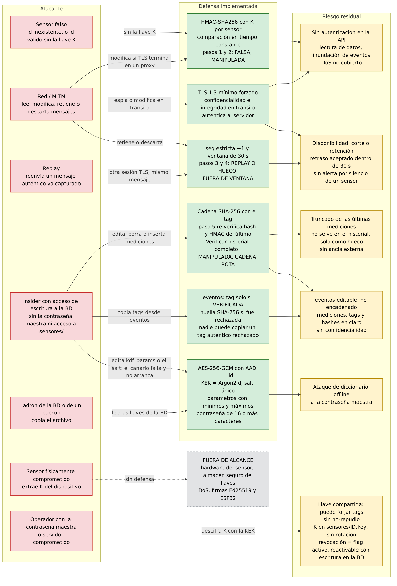

> Versión principal y resumida. El detalle está en los anexos de `docs/anexos/` (índice en `docs/anexos/README.md`); la versión íntegra se conserva en `docs/anexos/informe-completo.md`.

# 1. Motivación

## 1.1 El problema y lo que VIGÍA garantiza

Los sistemas IoT deciden a partir de mediciones (alarmas, riego, cadena de frío); si el dato es falso, la decisión lo es. Un atacante puede **modificar** una medición (en la red o ya guardada), **inventar** mediciones de un sensor inexistente o sin su llave, **repetir** mensajes legítimos (replay) o **alterar o borrar** el historial en la base de datos.

VIGÍA es un sistema de telemetría en el que el servidor **verifica criptográficamente** cada medición y el historial completo de cada sensor, y muestra el resultado en un dashboard.

| Propiedad | Significado | Mecanismo |
|---|---|---|
| Autenticidad | La medición la produjo el sensor autorizado (el que posee su llave K) | HMAC-SHA256 con llave por sensor |
| Integridad | No fue modificada; una modificación posterior se detecta (el último registro al ingerir, los intermedios con "Verificar historial completo") | HMAC; re-verificación |
| Frescura | Una medición antigua no se reutiliza | Número de secuencia estricto y ventana de timestamp |
| Historial | La secuencia mantiene su orden y no tiene huecos | Secuencia consecutiva y cadena de hashes SHA-256 que incluye el tag |

## 1.2 Qué NO garantiza VIGÍA

- **Confidencialidad de las mediciones.** Mediciones, tags y hashes se guardan **en claro**: VIGÍA no oculta los datos, los hace verificables. En la red los protege TLS 1.3, pero cualquiera con acceso a la base puede leerlos.
- No-repudio (el HMAC usa llave compartida, sección 8), ni protección frente a un sensor físicamente comprometido o a denegación de servicio (fuera de alcance).

En reposo solo se cifran las **llaves K**, porque permitirían forjar tags (sección 6.2).

# 2. Diseño: descripción del sistema y arquitectura

## 2.1 Componentes

El **núcleo criptográfico** (`vigia/crypto/`: formato canónico, HMAC, cadena, keystore con AES-256-GCM y Argon2id, verificador) son funciones puras sin E/S. Alrededor están el **simulador de sensor** (`vigia/sensor.py`), la **API y persistencia** (`vigia/server/`: FastAPI y SQLite parametrizado con ingesta atómica, y el dashboard), la **CLI** (`vigia/cli.py`) y `scripts/` (arranque con TLS 1.3, certificado de desarrollo, verificación de TLS, análisis estático).

## 2.2 Arquitectura



El sensor calcula el tag y envía el mensaje por HTTPS (TLS 1.3). Diagrama resumido; el detallado está en el Anexo A. La API valida el formato, descifra bajo demanda la llave K, ejecuta los cinco pasos de verificación y, si todo es correcto, guarda la medición con su hash de cadena. Cada intento con formato válido queda además en `eventos`. El dashboard consulta la API.

## 2.3 Modelo de datos, API y administración

SQLite (detalle y API completa en Anexo A, `docs/anexos/A-protocolo-y-flujos.md`):

| Tabla | Contenido |
|---|---|
| `meta` y `sensores` | Salt, parámetros y canario (no secretos); `llave_cifrada` y `activo` por sensor: K solo existe cifrada |
| `mediciones` | `seq`, `timestamp_ms`, `valor`, `tag`, `hash_prev`, `hash`; solo `VERIFICADA`: la cadena protegida |
| `eventos` | Todo intento con formato válido (`estado`, `detalle`, `tag`); **no está encadenada**. El `tag` es el HMAC solo si es `VERIFICADA`; si fue rechazada guarda `sha256:` + SHA-256 de `"vigia-huella-tag\|" + tag` |

**Por qué la huella.** Si `eventos` conservara el tag de un mensaje auténtico rechazado (p. ej. `FUERA DE VENTANA`), un insider con escritura en la BD podría copiarlo a `mediciones` como válido; la huella no es invertible ni utilizable como tag, y aun permite correlacionar intentos (hallazgo N1).

La ingesta es atómica (`BEGIN IMMEDIATE`: lee el último registro, verifica e inserta), así que dos mensajes simultáneos no pueden saltarse la comprobación de secuencia.

Endpoints principales: `POST /api/mediciones` (200 con `{estado, detalle}` también para las rechazadas; 422 si el formato es inválido), `POST /api/sensores/{id}/verificar-historial` y consultas `GET` que nunca incluyen la llave. Las respuestas llevan cabeceras de seguridad (CSP, HSTS) y el dashboard inserta texto con `textContent`.

# 3. Justificación de algoritmos y librerías

## 3.1 Resumen

| Función | Elección | Librería |
|---|---|---|
| Autenticación del mensaje | HMAC-SHA256, llave de 256 bits por sensor; `hmac.compare_digest` | `hmac`, `hashlib`, `secrets` (estándar) |
| Historial | Cadena SHA-256 que incluye el tag | `hashlib` |
| Llaves en reposo | AES-256-GCM, nonce de 96 bits aleatorio, AAD | `cryptography` 50.0.2 |
| Derivación de la llave | Argon2id, salt de 16 B | `argon2-cffi` 25.1.0 |
| Transporte | TLS 1.3 (mínimo forzado) | `ssl` sobre OpenSSL; Uvicorn |
| Aleatoriedad | `secrets` y `os.urandom` | estándar |

No se usa MD5, SHA-1, ECB ni ninguna construcción propia; Ed25519 (PyNaCl) y ESP32 real **no** están implementados. El código **no implementa ningún primitivo**, solo compone funciones de librerías probadas: un primitivo propio no tiene revisión pública y sus errores sutiles (canales laterales, nonces) son invisibles en pruebas funcionales. Versiones fijadas en `requirements.txt`.

## 3.2 HMAC-SHA256

**MAC simétrico y no firma digital.** El servidor es el único verificador y conoce a cada sensor desde el registro. Un MAC da autenticidad e integridad con una etiqueta de 32 bytes y costo mínimo, apropiado para dispositivos pequeños. Una firma (Ed25519) añadiría no-repudio, que el modelo no exige; el costo es que el servidor puede forjar tags (sección 8).

**HMAC y no `SHA-256(K || m)`:** la construcción ingenua sufre extensión de longitud. **SHA-256** es un hash vigente, sin ataques prácticos, y HMAC no depende de su resistencia a colisiones. La llave de 32 bytes tiene 256 bits de entropía.

**Qué cubre el tag.** El mensaje canónico completo (sección 4.1): versión, `sensor_id`, `seq`, `timestamp_ms` y `valor`. Cambiar cualquiera invalida el tag.

## 3.3 Comparación en tiempo constante

`verificar_tag` exige exactamente 64 hex en minúscula (si no, `False`), recalcula el HMAC y compara con `hmac.compare_digest`. Una comparación `==` termina en el primer byte distinto y filtra por tiempo cuántos acertó el atacante.

## 3.4 Cadena de hashes con el tag

```text
h_0 = 32 bytes en cero
h_i = SHA-256( h_{i-1} || mensaje_canónico_i || tag_i )      (h y tag como 32 bytes crudos)
```

Cada registro compromete al anterior y a la autenticación de su mensaje: borrar o editar uno intermedio rompe el enlace del siguiente. `h` y `tag` tienen largo fijo (32 B), así que la concatenación no es ambigua.

**Limitación que hay que decir con claridad.** SHA-256 no lleva llave: por sí sola la cadena no impide que alguien con escritura en la BD recalcule una cadena entera. Con el `seq` ya autenticado por el HMAC, la cadena sin llave no añade detección frente a un insider sin K más allá de HMAC+seq; aporta el enlace entre registros, un resumen verificable del historial y la posibilidad de un ancla externa. La detección viene del **HMAC**, por eso el paso 5 y la verificación completa lo re-verifican (hallazgo M1).

## 3.5 AES-256-GCM (llaves de sensor en reposo)

- **AEAD**: un blob alterado, o descifrado con otra contraseña, falla con `InvalidTag`.
- **Nonce de 96 bits** de `os.urandom`, **nuevo en cada cifrado**: repetir (llave, nonce) en GCM rompería el esquema; con pocos cifrados (uno por sensor y el canario) la colisión es despreciable.
- **AAD** = `b"vigia-sensor-key|" + sensor_id`: copiar el blob a la fila de otro sensor hace fallar el descifrado. El canario usa otro AAD.
- **Canario**: texto fijo cifrado al inicializar; con contraseña incorrecta no descifra y el servidor aborta.

## 3.6 Argon2id (derivación de la llave de cifrado)

La KEK (32 B) se deriva de la contraseña maestra con Argon2id: memory-hard, encarece los ataques de diccionario con GPU o ASIC si se roba la BD, y es la variante recomendada por RFC 9106. Se usan t=3, m=64 MiB, p=4 (RFC 9106 §4) y un salt de 16 B de `os.urandom`, único por base. La contraseña exige 16 caracteres como mínimo y se rechaza el valor de `.env.example`.

Los parámetros se guardan en `meta.kdf_params` y, como la BD puede haber sido alterada, se validan antes de derivar con **mínimos** (t >= 2, m >= 19 MiB, p >= 1, los de OWASP) y **máximos** (t <= 10, m <= 1 GiB, p <= 64) contra la denegación de servicio o excepciones no controladas (hallazgo N2; tabla en Anexo A). **Son defensa en profundidad:** editar `kdf_params` o el salt cambia la KEK, el canario no descifra y el servidor no arranca, así que una edición no puede abaratar la KEK real. Dentro de las cotas el mensaje es "contraseña incorrecta" (engañoso).

## 3.7 TLS 1.3 y por qué igual hace falta HMAC

VIGÍA fuerza TLS 1.3: el servidor fija `minimum_version = TLSv1_3` y el simulador usa `ssl.create_default_context(cafile=...)` (verifica cadena y hostname), sin `verify=False`. TLS protege el canal **en la red**, pero no resuelve el fondo:

| Riesgo | Por qué TLS no basta | Qué lo cubre en VIGÍA |
|---|---|---|
| Autenticidad del sensor extremo a extremo | TLS autentica al **servidor**; el sensor no presenta certificado de cliente y cualquiera que alcance el puerto abre una sesión válida. TLS termina en el servidor o un proxy: no dice quién generó el dato | HMAC con la K de cada sensor: sin K, `MANIPULADA`; id inexistente, `FALSA` |
| Replay a nivel de aplicación | Un mensaje legítimo reenviado en **otra** sesión TLS es válido para TLS | Secuencia estricta (+1) y ventana de timestamp |
| Huecos y orden | TLS entrega bytes; no sabe qué mediciones faltan ni su orden | Secuencia consecutiva y cadena con el tag |
| Manipulación de lo almacenado (insider o BD alterada) | Una vez guardado el dato, TLS ya no lo protege | Re-verificación de HMAC y cadena (historial completo; paso 5) |

Esto responde al comentario del profesor en la Entrega 1: TLS protege el tránsito; el HMAC se justifica por el origen, la frescura, el orden y la integridad de lo almacenado.

# 4. Protocolo y flujos criptográficos

## 4.1 Formato canónico `VIGIA-v1`

```text
VIGIA-v1|<sensor_id>|<seq>|<timestamp_ms>|<valor>
Ejemplo: VIGIA-v1|sensor-01|42|1763140000123|23.475
```

Se codifica en UTF-8 y es lo que se autentica con HMAC. Todos los campos se validan **antes** de calcular o verificar el tag (si no cumplen: HTTP 422 y no se toca la BD): `sensor_id` `[A-Za-z0-9_-]{1,64}`; `seq` entero de 1 a 2^63 - 1; `timestamp_ms` entero >= 0; `valor` decimal sin ceros a la izquierda (`-?(0|[1-9][0-9]{0,11})(\.[0-9]{1,6})?`).

**Por qué no es ambiguo.** `|` no puede aparecer en ningún campo, así que tuplas distintas nunca dan el mismo mensaje; `valor` se autentica **como cadena recibida** (nunca se reformatea un `float`); `fullmatch` evita el salto de línea final que aceptaría `$`; y el prefijo `VIGIA-v1` separa el dominio y versiona el formato (Anexo A).

## 4.2 Flujo del sensor



El simulador lee K y su último `seq` local, construye el mensaje canónico con `seq + 1` y el timestamp actual, calcula `tag = HMAC-SHA256(K, mensaje)` y envía el JSON `{sensor_id, seq, timestamp_ms, valor, tag}` por HTTPS verificando el certificado.

El sensor avanza su `seq` local solo si el servidor responde `VERIFICADA`. Única recuperación automática: si responde `replay: seq N <= última N` con N igual al `seq` enviado, la respuesta original se había perdido y el sensor avanza; ante un hueco no hay corrección automática. **Esa recuperación confía en la respuesta del servidor**: una fila final falsa con la `seq` esperada hace que el sensor descarte una medición antes de que aparezca `CADENA ROTA` (sigue fallando cerrado; nunca se encadena sobre la fila falsa).

## 4.3 Verificación en 5 pasos



`verificar_medicion` es una función pura y se detiene en el primer fallo. El orden es deliberado: primero se autentica (sin HMAC válido nada es confiable), luego la frescura y al final la integridad del almacenamiento.

| Paso | Pregunta | Si falla |
|---|---|---|
| 1 | ¿El sensor está registrado y activo? | **FALSA** |
| 2 | ¿El HMAC es válido (tiempo constante)? | **MANIPULADA** |
| 3 | ¿`seq` es exactamente última + 1 (o 1 si no hay registros)? | **REPLAY O HUECO** (`replay: seq N <= última M` o `hueco: esperaba E, llegó N`) |
| 4 | ¿`abs(ahora - timestamp)` está dentro de la ventana (30 s por defecto)? | **FUERA DE VENTANA** |
| 5 | ¿El último registro guardado es consistente? Recalcula su hash **y re-verifica su HMAC** | **CADENA ROTA** |
| - | Todo correcto | **VERIFICADA**: se guarda con `hash = SHA-256(hash_anterior ∥ canónico ∥ tag)` |

Puntos clave (notas completas en Anexo A): **FALSA** es exactamente "sensor no registrado o revocado" (id válido sin llave es `MANIPULADA`); **REPLAY O HUECO** es un solo estado y el motivo queda en `detalle`; un mensaje sin HMAC válido se rechaza **antes** de mirar la secuencia, así que quien no tiene K no puede consumir ni desincronizar la `seq`; `FUERA DE VENTANA` no consume `seq`; todo intento con formato válido queda en `eventos` y solo las `VERIFICADA` entran a `mediciones`; el paso 5 nunca lanza excepción por datos corruptos, devuelve `CADENA ROTA`.

## 4.4 Verificación de historial completo

`POST /api/sensores/{id}/verificar-historial` recorre los registros por `seq` y evalúa cada uno contra el anterior **tal como está guardado**: primero formato, pertenencia y HMAC (si falla, `MANIPULADA`), luego continuidad de `seq`, enlace `hash_prev` y hash recalculado (si falla, `CADENA ROTA`). Sirve también para sensores revocados (Figura 4). Casos esenciales (tabla completa en Anexo A):



| Acción sobre la BD | Resultado en "Verificar historial completo" |
|---|---|
| Alterar el valor de una intermedia | `MANIPULADA` en ese registro |
| Borrar una intermedia | `CADENA ROTA` en el registro siguiente |
| Insertar un registro con tag inventado, o una fila final falsa con hash recalculado | `MANIPULADA`; la siguiente ingesta legítima se rechaza y nunca se encadena sobre la fila falsa |
| Borrar los últimos registros | **No se ve en el historial** (queda una cadena válida más corta); operativamente aparece como `REPLAY O HUECO` en la siguiente medición |

## 4.5 Manejo de llaves



- **Generación y entrega.** `registrar-sensor` genera K de 32 B con `secrets.token_bytes` y la escribe en claro en `sensores/<id>.key` (0600, directorio 0700, `O_EXCL`) para simular la entrega fuera de banda; en un sensor real iría al firmware. **K también queda en claro en ese archivo, que permanece en disco** (no hay borrado tras la "entrega").
- **Cifrado en reposo y uso.** En la BD, K se cifra con AES-256-GCM (nonce nuevo, AAD = id) bajo la KEK = Argon2id(contraseña maestra, salt único). La KEK vive solo en memoria y K se descifra por cada verificación sin escribirse.
- **Revocación.** `revocar-sensor` pone `activo = 0` y lo posterior da `FALSA`; el historial sigue verificable. **Es solo un flag en la BD, sin protección criptográfica**: quien escriba en la BD puede reactivar el sensor, y quien tenga la K robada vuelve a obtener `VERIFICADA`. No hay rotación ni se borra el blob cifrado.
- **Arranque.** Con contraseña incorrecta o parámetros KDF fuera de cotas, no arranca.

# 5. Análisis de amenazas

## 5.1 Modelo de atacante y supuestos

Siete atacantes: **Red/MITM** (lee, modifica, retiene o descarta tráfico), **sensor falso** (id inexistente, o válido sin K), **replay**, **insider con acceso a la BD** (lee y *escribe* el SQLite; no conoce K ni la contraseña, no accede a `sensores/` ni controla el proceso), **ladrón de la BD o de un backup** (sin la contraseña), **operador con la contraseña maestra o servidor comprometido** (conoce la KEK) y **sensor físicamente comprometido** (extrae K).

Supuestos principales: K se genera con CSPRNG y queda también en claro en `sensores/<id>.key`, al que el insider no accede; la contraseña maestra es secreta y con entropía suficiente; las primitivas son seguras; el servidor no está comprometido y los relojes están sincronizados; el sensor verifica el certificado con `--cacert`. Lista completa en Anexo B (`docs/anexos/B-amenazas-detallado.md`).

## 5.2 Qué cubre TLS y qué no

TLS 1.3 cubre el **tramo de red** (confidencialidad e integridad del tráfico, autenticación del servidor). No cubre la autenticidad del sensor, el replay de aplicación, los huecos y el orden, ni la manipulación de lo almacenado (sección 3.7). TLS **detecta** la modificación en tránsito y corta la conexión, pero **no impide** que alguien descarte el tráfico.

## 5.3 Amenazas, mitigaciones y riesgo residual

La tabla completa, con el estado observable de cada mitigación, está en el Anexo B; aquí las filas principales.

| Amenaza | Mitigación | Riesgo residual |
|---|---|---|
| **Modificación o espionaje en tránsito** | TLS 1.3 forzado (TLS 1.2 rechazado): detecta y corta, pero no impide el descarte. Sin TLS, el HMAC da `MANIPULADA` ante cualquier cambio | Un proxy que termine TLS ve los datos (el HMAC no cifra); un certificado mal distribuido permitiría un MITM |
| **Sensor falso o id válido sin K** | Paso 1: `FALSA`. Paso 2: tag inválido, `MANIPULADA` (inviable de adivinar) | La respuesta permite enumerar ids, y `GET /api/sensores` los lista sin autenticación |
| **Replay** de un mensaje aceptado | Paso 3: `seq` exactamente última + 1, aunque llegue por otra sesión TLS | Ninguno para mensajes ya aceptados |
| **Hueco o descarte en tránsito** | El sensor no avanza su `seq` sin `VERIFICADA`; si no, `REPLAY O HUECO` (fail-closed) | Pérdida de disponibilidad, sin alerta por silencio |
| **Retraso / mensaje viejo** | `timestamp_ms` va en el tag; paso 4: fuera de ±30 s, `FUERA DE VENTANA`, sin consumir `seq` | Un mensaje retenido y entregado dentro de la ventana se acepta si su `seq` es la esperada |
| **Alteración o borrado intermedio** (insider sin K) | Alterar: `MANIPULADA` en el historial (HMAC); borrar: `CADENA ROTA` en el siguiente (`seq` y enlace). Si es el último, la ingesta siguiente da `CADENA ROTA` | Solo se ve al verificar el historial, acción manual |
| **Inserción de una fila final falsa** | SHA-256 sin llave no lo impide; el paso 5 re-verifica el HMAC del último: `CADENA ROTA` (`REPLAY O HUECO` si la `seq` no es la esperada); nunca se encadena sobre la fila falsa | La recuperación automática del sensor confía en el servidor y puede descartar una medición antes de `CADENA ROTA` |
| **Promoción de un mensaje rechazado** y **edición de `eventos`** | `eventos` guarda el tag solo si fue `VERIFICADA`; si fue rechazada, una huella no invertible (N1). No está encadenada ni afecta a `mediciones` | La huella solo correlaciona intentos. El registro de intentos no es confiable ante un insider |
| **Truncado de las últimas mediciones** | No se ve en el historial (queda una cadena válida más corta); operativamente, la siguiente medición llega con hueco y recibe `REPLAY O HUECO` (N3) | Sin ancla externa; no distingue truncado de desincronización |
| **Robo de la BD o de un backup; contraseña débil** | K cifrada con AES-256-GCM bajo una KEK Argon2id (salt único); contraseña de 16+ caracteres | Mediciones y eventos **en claro**. Diccionario offline posible (el canario es verificador), frenado por Argon2id; si la contraseña es débil se comprometen todas las K |
| **Servidor comprometido o insider con la KEK (llave compartida)** | Ninguna: quien tiene la KEK descifra cada K, forja tags e inserta mediciones con cadena consistente. Sin no-repudio | **Alto, aceptado.** Futuro: Ed25519 por sensor |
| **API sin autenticación / DoS** | Escucha en 127.0.0.1 por defecto; sin K nada se acepta y un mensaje sin HMAC válido no consume `seq` | Cualquiera que alcance el puerto lee datos y llena `eventos`; sin límite de tasa. DoS fuera de alcance |
| **Sensor físicamente comprometido** | **Fuera de alcance.** Revocar hace que lo posterior dé `FALSA` | Sin almacén seguro ni rotación; `sensores/<id>.key` queda en claro; la revocación es un flag reactivable con escritura en la BD |

## 5.4 Diagrama del modelo de amenazas



## 5.5 Lectura de conjunto

Está **cubierto por diseño** lo que ocurre sin K (tránsito, falsificación, replay, mensajes viejos, alteración, borrado intermedio e inserción); se detecta **solo bajo demanda u operativamente** la alteración intermedia (hay que pulsar "Verificar historial completo") y el truncado (se ve como hueco); se **acepta como limitación** la forja por el servidor o el operador con la KEK, la API sin autenticación, la poca confiabilidad de `eventos` y la falta de confidencialidad; y queda **fuera de alcance** el sensor físicamente comprometido y la denegación de servicio.

# 6. Seguridad práctica

## 6.1 En tránsito: TLS 1.3 forzado

El certificado autofirmado de `scripts/generar_cert.sh` es **solo de desarrollo** (EC P-256, SAN `127.0.0.1`/`localhost`, 365 días; `certs/` está en `.gitignore`). `scripts/run_server.py` fija TLS 1.3 como versión mínima y el simulador exige `--cacert`. Evidencia (`docs/evidencia/tls-y-simulador.txt`, `scripts/verificar_tls.sh`):

| Prueba | Resultado |
|---|---|
| `openssl s_client -tls1_3` | `TLSv1.3`, `TLS_AES_256_GCM_SHA384`, `Verify return code: 0 (ok)` |
| `openssl s_client -tls1_2` | Rechazado: `Cipher is (NONE)` |
| `curl --tls-max 1.2` y `curl` sin `--cacert` | exit 35 (handshake) y exit 60 (certificado no confiable) |
| Simulador con `--cacert`, 3 mediciones | 3 × `VERIFICADA`; historial `integro: true` |

## 6.2 En reposo

En reposo, **solo las llaves K se cifran** (`sensores.llave_cifrada`: AES-256-GCM con KEK Argon2id), porque son el secreto que permitiría forjar tags. Mediciones, tags, hashes y eventos van **en claro**: VIGÍA protege integridad, no confidencialidad (en `eventos` el tag completo solo aparece en las `VERIFICADA`). La contraseña maestra no está en la BD ni en el repo (variable de entorno o `.env`, ignorado por git) y `sensores/<id>.key` queda en claro (0600) para simular la entrega.

`scripts/mostrar_bd.py` muestra la BD robada: sin contraseña, imprime el blob de `sensores` (48 B: 32 cifrados y 16 de tag GCM), comprueba que la llave en claro no aparece en él y muestra las mediciones en claro. Para confidencialidad se añadiría cifrado de columnas. Llaves, certificados, `.env`, `sensores/`, `data/` y `*.db` están en `.gitignore`; solo `.env.example`, sin secretos, es público.

## 6.3 Análisis estático

**bandit** 1.9.4 (patrones inseguros) y **pip-audit** 2.10.1 (dependencias vulnerables), Python 3.14.10, con `scripts/analisis_estatico.sh`; resultados en `docs/analisis-estatico/`.

| Alcance | Herramienta | Resultado |
|---|---|---|
| Código de la aplicación (`vigia/` y `scripts/`, 1670 líneas) | bandit | **0 hallazgos** |
| Dependencias de ejecución y de desarrollo | pip-audit | **0 vulnerabilidades conocidas** |
| Tests (`tests/`, 1053 líneas) | bandit | 202 hallazgos: 201 × B101 (`assert`) y 1 × B105, **falsos positivos** |

Los B101 son el mecanismo de pytest (sin `assert` en producción) y el B105 es la contraseña de prueba de BD temporales. El código sale limpio: consultas parametrizadas, sin `subprocess`, `eval` ni `pickle`, aleatoriedad de `secrets` y `os.urandom`, sin hashes rotos ni modos inseguros (el único `random` es el ruido del simulador). **Limitación:** bandit analiza patrones y **no prueba la ausencia de errores lógicos** (p. ej. un orden incorrecto de los pasos); se complementa con tests y revisión independiente. Detalle en Anexo C.

# 7. Resultados

## 7.1 Qué se logró frente al diseño

Implementado: HMAC-SHA256 por sensor, formato `VIGIA-v1`, verificación de 5 pasos con los 6 estados, cadena con el tag, verificación de historial, AES-256-GCM con nonce único y AAD, Argon2id con salt único, huella del tag en `eventos`, TLS 1.3 comprobado, simulador, API, dashboard, CLI y análisis estático. **No implementados** (extensión): Ed25519 y ESP32 real.

## 7.2 Pruebas

`.venv/bin/python -m pytest -q` ejecuta **266 tests, todos pasan** (una advertencia de deprecación, ajena a la seguridad). Hay un test por cada estado y por cada ataque considerado (alterar un valor, fabricar con y sin id válido, replay, borrar una intermedia, mensaje perdido, timestamp fuera de ventana, romper la cadena, contraseña incorrecta, blob copiado a otro sensor), más pruebas de formato canónico, unicidad de salts y nonces, y regresiones de cada hallazgo. Desglose por archivo en el Anexo C.

## 7.3 Hallazgos de la revisión independiente y su corrección

Dos rondas de un revisor distinto de quien implementó (cierre de la Fase 2 y re-verificación al inicio de la Fase 3); cada corrección de código tiene tests de regresión. Los hallazgos relevantes (lista completa de 16 en el Anexo C):

| Id | Severidad | Hallazgo | Corrección |
|---|---|---|---|
| M1 | Media | El paso 5 no re-verificaba el HMAC del último registro: una fila final falsa con hash recalculado servía de base de la cadena | El paso 5 re-verifica el HMAC del último además de su hash. Corregido |
| M2 | Media | Limitaciones no documentadas y una afirmación falsa en `seguridad-practica.md` | Documentadas y corregida. Corregido |
| B1 | Baja | El sensor quedaba en bucle de `REPLAY O HUECO` tras perder una respuesta | Avance automático solo si el servidor ya tiene esa `seq`; el resto, manual. Corregido |
| N1 | Baja | `eventos` guardaba el tag de todo intento: se podía copiar el de un mensaje auténtico rechazado a `mediciones` | Tag solo si `VERIFICADA`; huella SHA-256 si fue rechazada. Corregido |
| N2 | Baja | Sin cotas superiores en Argon2: DoS o excepción al arrancar con `kdf_params` manipulados | Máximos además de mínimos; excepciones convertidas en error de arranque claro. Corregido |
| N3 | Info | Precisión sobre el truncado: no se ve en el historial, sí como hueco | Documentado (sección 8) |

El resto son hallazgos menores o informativos, todos cerrados o documentados: API sin autenticación (limitación), política de contraseña mínima, uso de los parámetros Argon2 guardados, HTTP 500 genérico ante una llave corrupta, permisos 0600/0700 y evidencia de TLS.

# 8. Limitaciones

Límites aceptados (tabla completa en el Anexo B).

- **Re-sincronización manual (fail-closed):** el sensor se recupera solo si el servidor ya tiene exactamente esa `seq`; ante un hueco, o si se pierde `sensores/<id>.seq`, queda en `REPLAY O HUECO` hasta re-sincronizar.
- **`eventos` no está encadenada:** un insider puede editarla; la tabla protegida es `mediciones`.
- **Alteración intermedia solo con "Verificar historial completo"** (la ingesta re-verifica el último registro).
- **Truncado:** no se detecta en el historial (sin ancla externa); operativamente aparece como hueco (`REPLAY O HUECO`) si el sensor sigue enviando.
- **HMAC de llave compartida:** el servidor puede forjar tags; sin no-repudio.
- **API y dashboard sin autenticación** (escuchan en 127.0.0.1 por defecto); DoS fuera de alcance.
- **Alterar el `seq` del último registro** da `REPLAY O HUECO` y no `CADENA ROTA` (la secuencia va antes que la cadena); en ambos casos se rechaza.
- **K también queda en claro en `sensores/<id>.key`**, sin borrado ni rotación; quien lo lea (o su respaldo) forja tags de ese sensor.
- **La revocación es un flag sin protección criptográfica:** un insider con escritura en la BD puede reactivar el sensor; revocar de verdad exigiría rotar K.
- **La recuperación automática del sensor confía en la respuesta del servidor:** una fila final falsa con la `seq` esperada hace descartar una medición; sigue fallando cerrado.
- **Contraseña:** la política es de largo, no de entropía; el canario permite diccionario offline frenado por Argon2id.
- **`kdf_params` editable:** los límites de Argon2 son defensa en profundidad; editarlos solo puede impedir el arranque.
- **Reloj:** la ventana de 30 s depende de relojes sincronizados; la defensa principal contra el replay es la secuencia.
- **Otras:** Chart.js desde CDN con SRI, certificado autofirmado, sensor simulado.

# 9. Cambios respecto a la Entrega 1

| Tema | Entrega 1 | Implementación |
|---|---|---|
| `FALSA` | Ambigua (fabricación) | Solo sensor no registrado o revocado; id válido sin llave: `MANIPULADA` |
| `REPLAY O HUECO` | Replay y hueco | Un solo estado; el motivo va en `detalle` |
| Cadena de hashes | `h_i` sobre el mensaje | `h_i = SHA256(h_{i-1} ∥ mensaje ∥ tag_i)`: incluye el tag |
| Paso 5 | Consistencia de la cadena | Además re-verifica el HMAC del último registro |
| Alterar una intermedia | `CADENA ROTA` | `MANIPULADA` (el HMAC va antes que la cadena); borrar sigue dando `CADENA ROTA` |
| HMAC, Argon2id, TLS | Justificación implícita; salt único; TLS 1.3 | HMAC justificado por lo que TLS no cubre (3.7); parámetros Argon2 con mínimos y máximos y política de contraseña; TLS 1.3 mínimo forzado y comprobado |
| `eventos` | No se especificaba | Tag solo si `VERIFICADA`; huella si fue rechazada (N1) |
| Truncado | No se trataba | No se ve en el historial; aparece como `REPLAY O HUECO` (N3) |

# 10. Conclusiones y trabajo futuro

## 10.1 Conclusiones

- Un MAC simétrico, una secuencia estricta y una cadena de hashes dan autenticidad, integridad, frescura e historial **además** de TLS, y cubren lo que este no cubre: origen extremo a extremo, replay de aplicación, orden y manipulación de lo almacenado.
- Un diseño por capas exige cuidado en la composición: una cadena sin llave no basta sola (M1) y los tags guardados en `eventos` eran una vía de promoción (N1).
- La criptografía proviene de librerías probadas; el análisis estático y los 266 tests respaldan la implementación (sin sustituir una revisión experta).

## 10.2 Trabajo futuro

1. **Firmas Ed25519 por sensor** (PyNaCl) para eliminar la llave compartida y dar no-repudio; sensor real (ESP32).
2. **Ancla externa** del último hash y `seq` para detectar truncado.
3. Encadenar o firmar `eventos`; autenticación de la API y límite de tasa.
4. Verificación completa periódica con alertas; rotación de llaves y borrado seguro al revocar; almacén seguro en el sensor.
5. Chart.js local, certificados de una CA real y cifrado opcional de columnas.

# Anexos

Cómo reproducir, con comandos: Anexo D (`docs/anexos/D-reproducir.md`). Otros: A (`A-protocolo-y-flujos.md`), B (`B-amenazas-detallado.md`) y C (`C-revision-seguridad.md`). Diagramas en `docs/diagramas/`. Conversión: `pandoc informe.md -o informe.pdf` desde `docs/` (las imágenes usan rutas relativas a `docs/`).
